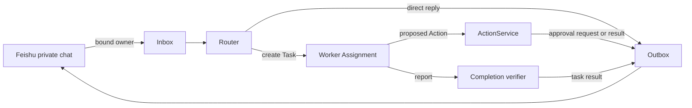

# Repository Guidelines

## Project Overview

Personal Agent is a self-hosted assistant for one explicitly bound Feishu user. It manages tasks, reminders, memory, and GitHub project reviews through private chat. A **Mandate** defines a Task’s scope. An **Approval** authorizes one Action with specific parameters. [Domain glossary](CONTEXT.md)

## Architecture & Data Flow

The default Node host and the optional Cloudflare Durable Object both call `createApp(deps)`. Keep business rules in shared services. Inject the store, runtime, Router model, and wake scheduler at the host boundary. [Composition root](apps/agent/src/app.ts)

Ingress persists and deduplicates messages by channel, account, and Feishu `message_id` before model work. The Router handles commands directly and schedules model decisions as durable effects. Each ready Plan step becomes a child Task, reusing Worker budgets, approvals, and verification. [Ingress](apps/agent/src/coordinator/ingress.ts) · [Plan executor](apps/agent/src/coordinator/plan-executor.ts)

## Key Directories

| Under `apps/agent/src/` | Where to make changes |
| --- | --- |
| `coordinator/`, `personal/` | Routing, Task and Plan transitions, or owner-scoped memory, reminders, and projects |
| `storage/`, `delivery/` | SQLite repositories and migrations, or dispatch of durable effects and outbound messages |
| `actions/`, `plugins/` | Tool approval and execution, or capability registration and permissions. Root `skills/` supplies guidance only. |
| `channels/`, `runtime/` | Feishu transport and Pi session adapters, respectively |

## Development Commands

Run from the repository root. For first-time startup, copy `.env.example` to `.env` and set `FEISHU_APP_ID`, `FEISHU_APP_SECRET`, `FEISHU_VERIFICATION_TOKEN`, and `OWNER_FEISHU_OPEN_ID`. Model-backed tasks also need `OPENCODE_API_KEY`.

| Purpose | Command |
| --- | --- |
| Install locked dependencies | `npm ci` |
| Check configuration and start Node | `npm run preflight` then `npm start` |
| Query the running service | `npm run pa -- status` with `PA_API_TOKEN` or a local `ADMIN_TOKEN` |
| Check types and scan for secrets | `npm run typecheck` and `npm run scan:secrets` |
| Run all tests or one suite | `npm test` or `node --test apps/agent/test/ingress.test.ts` |
| Build the Node image | `docker build -t personal-agent:local .` |
| Run or bundle the optional Worker locally | `npm run dev:cloudflare` or `npm run deploy:dry-run` |

## Code Conventions & Common Patterns

- Match two-space indentation, double quotes, and semicolons. Use kebab-case filenames, PascalCase types, camelCase functions, explicit `.ts` imports, and `import type` for types.
- Keep SQLite transactions synchronous. Claim work under a lease, commit, then await external I/O. Give effects stable business keys and reschedule long model waits in short slices. Record ambiguous sends or writes as `unknown` and reconcile before retrying.
- Check Task revision, Assignment fencing token, and input sequence before accepting a Worker report. Route tool calls through `ActionService`, which rechecks the Mandate at execution. [Task lifecycle](apps/agent/src/coordinator/tasks.ts) · [Action service](apps/agent/src/actions/service.ts)

## Important Files

| Change | Start here |
| --- | --- |
| Host startup and adapter wiring | [Node entry](apps/agent/src/main.ts) · [Durable Object entry](infra/src/worker.ts) |
| CLI or TUI behavior | Both clients use authenticated `/api/v1` through the SDK. Keep changed routes and their OpenAPI definitions in sync. [CLI entry](apps/agent/src/cli.ts) · [SDK](apps/agent/src/client/sdk.ts) · [API handlers](apps/agent/src/client-api.ts) · [OpenAPI](docs/api/openapi.json) |
| Schema upgrades | Append application migrations and test an upgrade from an older database. [Shared schema](apps/agent/src/storage/schema.ts) · [Compatibility suite](apps/agent/test/migration-compat.test.ts) |

## Runtime/Tooling Preferences

Use npm workspaces and Node 26. CI pins `26.12.0` via `.nvmrc`. Node runs erasable TypeScript directly as ESM. `tsc` checks both hosts with `noEmit`. The root manifest omits standalone `build` and `lint` scripts. [Package scripts](package.json) · [Compiler options](tsconfig.base.json)

On Node, `data/agent.sqlite` owns application state (`pa_*`) and `data/pi.sqlite` holds Pi sessions (`pi_*`). Keep the files separate and back them up together with `npm run backup`. [Hosting decision](docs/adr/0001-runtime-hosting.md)

## Testing & QA

Use `node:test` and `node:assert/strict`. Start with `createStore()` for owner-bound in-memory SQLite or `createServices()` for a fake runtime and injectable clock. Use synthetic IDs in fixtures. For restart behavior, use temporary database files and run `npm run test:recovery`. [Test helpers](apps/agent/test/helpers.ts) · [Service fixtures](apps/agent/test/services.ts)

CI runs the suite on Linux, macOS, and Windows. For packaging changes, `npm run install:smoke` installs a clean copy, runs tests, and checks server health. [CI workflow](.github/workflows/ci.yml)

Coverage follows a fixed 40-scenario catalog. `npm run eval:report` writes results to `evals/reports/` and excludes pending scenarios from the pass rate. Report deterministic tests as E1. Use the acceptance runbook for real Feishu end-to-end evidence (E3) and fault-recovery evidence (E4). [Scenario catalog](evals/scenarios.ts) · [Evidence levels](docs/08-evaluation.md) · [Acceptance runbook](docs/22-mvp-acceptance-runbook.md)
