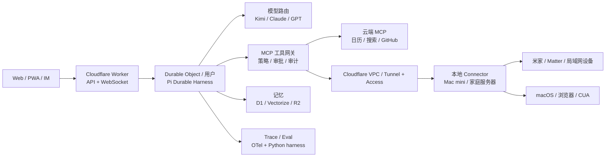

# Personal Agent

> 云端大脑 + 本地手脚 + 可审计执行：一个可长期运行、能主动做事、但不会绕过人的个人 Agent。

本仓库当前处于 **调研 / 架构 / 可行性验证** 阶段，不是完成品。仓库里已包含一个可运行的 Pi Durable 本地 spike，用于验证“持久化 transcript + 工具调用 + 审批拦截 + 重启恢复”这条核心链路。

## 结论先行（2026-11-04）

| 问题 | 结论 |
|---|---|
| 截图里的 `Pi Durable + Pi SDK + Cloudflare` 是否真实存在？ | **是。** Pi 1.0 与 Pi Durable 于 2026-10-01 发布；Cloudflare Agents SDK 的 `PiHarness` 于 2026-10-02 进入 beta，官方文档在 2026-11-03 仍在更新。 |
| 这套栈能不能做 personal agent？ | **能，但 PiHarness 仍是 beta、Pi Durable 仍是 experimental。** 适合个人项目/求职作品，不适合直接当生产系统。 |
| 截图里的“Kimi computer use MCP”是什么？ | **要分两层。** 官方确实有 **KimiCU.app**（Kimi Work 插件 + 本地 macOS 桌面操作 MCP server，18 个工具，Moonshot 签名/公证），但它是**本地能力层**，不是云端模型能力；只支持 **Apple Silicon macOS 14+**，锁屏即失效，不能部署在 Cloudflare/Linux。另有 `songkeys/kimi-computer-use` 社区桥接，借本机 OpenAI Computer Use 给 Kimi Code，依赖 ChatGPT/Codex，且会自动接受 app 访问、用 unrestricted Codex 沙箱，风险更高。 |
| 米家 MCP 能不能接？ | **能，但属于非官方链路。** 社区实现通过米家账号二维码登录拿 token，走小米云 API；token 会过期，设备覆盖取决于 MIoT 映射，存在风控与隐私风险。社区 MCP **没有可用的局域网直连**；唯一 LAN 路径是官方 Xiaomi Miloco（中枢网关 + mTLS，非商业许可），但它不是 MCP。 |
| 对 Agent 开发岗位的适配度？ | **Agent Harness/Runtime 最强，应用/平台方向强，算法/Infra 方向中等。** 项目能证明 MCP、工具编排、记忆、评测、可观测性、HITL、长任务与 durable execution；缺的是 K8s/Go/大规模并发、训练/RL、推理服务。 |
| 最值得做的差异化是什么？ | 不是“再做一个 RAG 聊天机器人”，而是 **durable execution + 副作用审批 + 云端/本地分层 + 可复现评测**。这四件事在候选人项目里明显更稀缺。 |

## 推荐方案（一句话）

用 **Cloudflare Durable Object 承载 Pi Durable 的持久化 Agent runtime**，用 **MCP 工具网关 + 两阶段审批** 管住副作用，用 **本地 connector（Mac mini / 家庭服务器）** 接米家与 macOS 能力，用 **Python eval harness + OTel trace** 把“感觉能用”变成可验证指标。



> 上图是目标态；MVP 只做其中一条竖切：**聊天 → 工具 → 审批 → 执行 → 审计 → 记忆**，再加一个定时任务和一个米家只读/单控演示。

> **本机约束**：当前开发机是 **x64 macOS**；官方 KimiCU 二进制是 **arm64-only**，无法直接运行。桌面能力请先以 Playwright MCP / Browser Run 替代；要用 KimiCU 需 Apple Silicon Mac。详见 `docs/01-feasibility.md` §3.4。

## 选型清单（结论）

| 用 | 不用 / 缓用 |
|---|---|
| Pi Durable + Cloudflare `PiHarness`，锁定 `agents@0.33.0` / `pi-durable@1.5.0` | 不追 Pi minor 升级；不把 beta 当生产基座 |
| Workers VPC（beta）或 Tunnel + Access 接本地 MCP | 不把本地 MCP 直接暴露公网；不把 Access 当 MCP OAuth AS |
| Playwright MCP / Browser Run 做 Web 任务 | 不把 KimiCU 当云端核心；社区 Kimi 桥不用于正式链路 |
| 米家只读 + 单灯控制，先 mock 后真机 | 不碰门锁/摄像头/支付；不依赖非官方 API 做无人值守 |
| 两阶段审批 + 幂等 + 审计 + 40 条 eval | 不让模型直接持有副作用执行权；不写“生产级”而没有数字 |

## 下一步（按顺序）

1. **Week 1**：部署 Cloudflare 骨架 + PiHarness + 流式聊天；若 2 周内无法稳定恢复，切 Cloudflare Agent + AI SDK。
2. **Week 2**：MCP 适配器 + 3 个工具 + `propose_action`/审批/审计；先 mock，后接真机。
3. **Week 3–4**：记忆 + 定时 + 本地 connector；用 Workers VPC（或 Tunnel + Access）。
4. **Week 5–6**：40 条 eval + 故障注入 + OTel + 5 分钟 Demo；用实测数字替换简历里的 `X/Y/Z`。

## 文档索引

| 文档 | 内容 |
|---|---|
| [`docs/01-feasibility.md`](docs/01-feasibility.md) | 截图逐项核实、技术栈可行性、限制、成本、替代方案、Go/No-Go |
| [`docs/02-architecture.md`](docs/02-architecture.md) | 目标架构、数据模型、关键流程、审批状态机、安全与可靠性设计 |
| [`docs/03-job-fit.md`](docs/03-job-fit.md) | 2027 校招/社招 JD 证据、能力矩阵、简历 bullet、面试讲法 |
| [`docs/04-build-plan.md`](docs/04-build-plan.md) | 6 周 MVP 计划、验收标准、评测集、Demo 脚本、风险登记 |
| [`docs/05-jd-appendix.md`](docs/05-jd-appendix.md) | 17 个中国 + 7 个海外岗位样本、能力计数、链接底稿 |
| [`spikes/pi-durable-smoke/`](spikes/pi-durable-smoke/) | 已运行的 Pi Durable 本地 spike |

## 已运行的 spike

```bash
cd spikes/pi-durable-smoke
npm install
npm run smoke
```

实测结果（2026-11-04，Node 26.12.0，`@earendil-works/pi-durable@1.5.0`）：

```json
{
  "answer": "I need approval before doing that.",
  "executed": false,
  "toolResult": "<harness>\n[error] Tool call blocked: Needs human approval\n</harness>",
  "entryCount": 5
}
{
  "reopenedEntryCount": 5,
  "sameRoot": true
}
```

它证明了四件事：

1. Pi Durable 能把 transcript 落到 SQLite；
2. 工具调用会经过 `beforeTool` hook；
3. hook 可以在副作用发生前阻断调用，模型会收到结构化的 error result；
4. 关闭并重新打开同一个 SQLite 文件后，root session 与 5 条 entry 仍在。

这正好是“审批 + 持久化”原语的可行性证据；真正的审批 UI、token、执行器分离还需要在架构层补齐（见 `docs/02-architecture.md`）。

## 非目标

- 不做通用桌面自动化产品，不承诺“任意 GUI 任务都能跑”。
- 不做多租户 SaaS；MVP 是单用户、单 Agent、可审计。
- 不训练模型；模型只通过 provider 抽象接入。
- 不把米家/银行/密码管理器等高风险能力作为第一个 demo。
