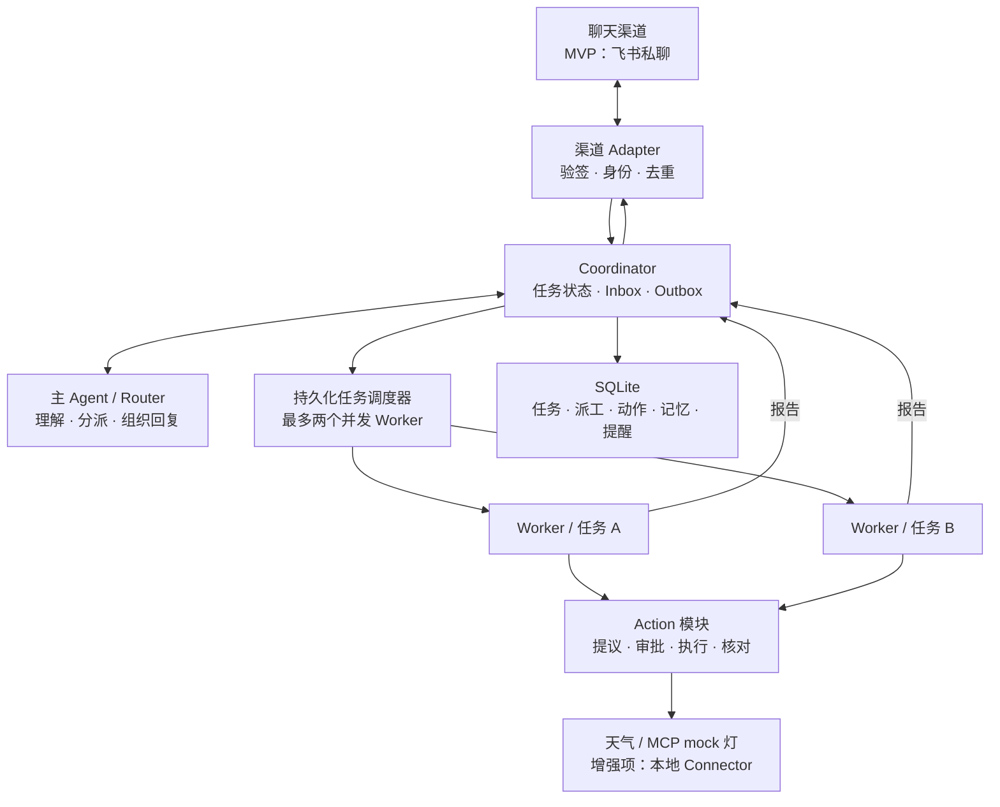

# Personal Agent

Personal Agent 是单 owner 自托管助手。默认 Node 服务通过飞书私聊接收请求，把任务、计划和审批持久化到 SQLite；CLI/TUI 通过同一服务操作。Cloudflare Durable Object 是可选宿主，见[宿主决策](docs/adr/0001-runtime-hosting.md)。

## 当前实现

以下核对到 [PR #127 合并后的 main](https://github.com/yuanbaoerer/personal-agent/commit/242a9f20d25ce3b342fc9dc30b8c353d070b70f4)。**E1 是确定性测试，E3 是指定场景的真实使用，E4 是故障恢复证据**。一个场景通过，不替另一个场景签收。

| 工作线 | 已合并或已验证 | 未通过的门槛 / 跟踪 |
| --- | --- | --- |
| 飞书与任务核心 | Node 长连接、owner 绑定、Inbox 去重、Outbox 投递、Task revision/输入序号、Worker 租约与审批。显式状态查询、记忆、提醒、周期任务和预算守卫已接入。 | [#41](https://github.com/yuanbaoerer/personal-agent/issues/41) 的 M01–M14 单独验收；[状态问答 #38](https://github.com/yuanbaoerer/personal-agent/issues/38)、真实并发与常驻恢复不能从聊天成功推断。 |
| 多轮对话与计划 | #89–#91、空会话草稿 [#123](https://github.com/yuanbaoerer/personal-agent/issues/123) 与步骤时限 [#126](https://github.com/yuanbaoerer/personal-agent/issues/126) 已合并（E1）；已有对话窗口、持久 Plan/Steps、修订差异、子任务执行、有界重规划和绝对派工截止时间。[真实飞书记录](docs/acceptance/2026-11-22-conversational-planning-runbook.md)：C01 六轮聊天通过；C02/C03 草稿与修订通过（使用预建、未派发的父任务）。 | [#92](https://github.com/yuanbaoerer/personal-agent/issues/92)：C04/C11 仅部分通过，前两步核验成功，第三步未交付最终报告。空会话草稿真实飞书复验、C05–C10、C12 成本基线与运行中重启 E4 仍未完成。 |
| GitHub 项目评估与 Issue 写入 | 已绑定项目可读固定 SHA 源码、PR 和 CI；[真实模型只读评估](docs/acceptance/2026-11-22-real-project-review.md)核对了结构化声明并生成待批草稿，未独立核实叙述结论。独立写凭据、逐次审批的 Issue 创建/更新/评论已合并（E1）。 | [#65](https://github.com/yuanbaoerer/personal-agent/issues/65)：还需飞书收到完整评估；[#61](https://github.com/yuanbaoerer/personal-agent/issues/61) 的真实写入只在 owner 指定的隔离仓库验收。Coding Agent / Draft PR 尚未交付。 |
| 扩展与 GitHub 连接 | 受信内置插件、按需加载的 Skills、任务级权限和只读远程 MCP 已接入。[GC-00/01](docs/29-github-one-click-connection.md) 已交付加密凭据存储、连接 API 和 `pa plugins login/status/logout github`（E1）。 | [#68](https://github.com/yuanbaoerer/personal-agent/issues/68)：真实登录、重启、断连及旧授权失效待验；仓库发现、TUI 连接页、公共 GitHub App 未交付。[#73](https://github.com/yuanbaoerer/personal-agent/issues/73) 另跟踪 SDK 与分发。 |
| 运维与客户端 | 本地 [Client API / CLI / TUI](docs/20-local-client-api.md) 支持设备 token、审批、事件与 SSE；双库可备份、校验并恢复到空目录；`/usage` 采集模型 token、provider/catalog 费用来源与 Worker 端到端延迟。 | 远程配对、Desktop、真机终端验收与 DO 驱逐恢复不在上述 E1 证据内；C12 仍需真实运行记录。 |

[#125 空会话草稿](https://github.com/yuanbaoerer/personal-agent/pull/125) 与 [#127 步骤时限](https://github.com/yuanbaoerer/personal-agent/pull/127) 已合并（E1）。下一步由 owner 在部署后从无预置父任务的飞书会话复验 #123，并在同一次受控只读运行中交付 C04/C11 最终报告与真实飞书收件。分工、证据与暂缓项见[规划实施表](docs/28-conversational-planning-mvp.md#5-交付依赖pr-顺序及并行化)。

## 本地启动

```bash
npm ci
npm test
npm run typecheck
cp .env.example .env   # 填入飞书应用凭据与主人 open_id
npm start
```

干净目录安装冒烟（不复制 `node_modules/.env/data/.git`，会执行 `npm ci`、typecheck、完整测试、CLI help、临时启动 + `/healthz`）：

```bash
npm run install:smoke   # also run by the Ubuntu install-smoke CI job
```

本地操作（服务启动后）：

```bash
npm run pa -- status
npm run pa -- tasks
npm run pa -- approvals
npm run pa -- tui
npm run pa -- plugins list
npm run pa -- plugins disable github --yes
npm run pa -- skills list
# 需要 copy 一次 token 时：
npm run pa -- tokens create --name laptop --scopes read,write
```

CLI/TUI 只走 `http://127.0.0.1:8787/api/v1`，使用 `PA_API_TOKEN`（或本地 bootstrap 的 `ADMIN_TOKEN`）；不会直接打开 SQLite。详见 [20 · 本地 Client API](docs/20-local-client-api.md)。

默认数据库为 `./data/agent.sqlite`（`pa_*` 应用状态）与 `./data/pi.sqlite`（`pi_*` Pi 会话），两者都要备份；`OWNER_FEISHU_OPEN_ID` 是显式操作员绑定，不从昵称或消息正文推断。宿主方向见 [ADR-0001](docs/adr/0001-runtime-hosting.md)。

**Docker 自托管（E1）**：

```bash
cp .env.example .env   # 必填飞书凭据、OWNER_FEISHU_OPEN_ID；首次建议 long_connection
docker compose build && docker compose up -d
curl -fsS http://127.0.0.1:8787/healthz
```

容器以非 root、只读根文件系统运行，命名卷 `agent-data` 持久化两份 SQLite；preflight 缺配置直接退出。详见 [16 · 自托管部署](docs/16-self-hosting.md)。镜像未发布 registry，arm64、真实 E3/E4 和定期备份仍 pending。

**License:** 尚未声明。D16 决策前不得把本仓库描述为已获得开源许可或可再分发。安全报告见 `SECURITY.md`。

**GitHub 连接：** 自托管使用仓库级只读 PAT 或自备 OAuth App；连接账号不会自动绑定项目或取得 Issue 写权限。见[登录配置](docs/19-github-oauth.md)。

## 历史验证记录

以下按日期保留当时的结果；旧测试数、待办和运行环境不代表当前状态。

**2026-11-09 验证：**

- **真实飞书 p2p**：入站 `message_id=<redacted-feishu-message-id>` 受理；回调 `POST /webhooks/feishu` 200，约 13ms；主人 `<redacted-owner-open-id>` 绑定；出站 `platform_message_id=<redacted-feishu-message-id>` 被平台接受，端到端约 2s。当前走本地 Node 长连接（`FEISHU_EVENT_MODE=long_connection`），无需 Tunnel；长连接事件日志为 `feishu_ws_event`，出站 `<redacted-feishu-message-id>`。
- `npm test`：106 个确定性测试通过，覆盖 Inbox/Outbox、Task/Assignment fencing/心跳、原子审批、取消后 reconcile 拒绝执行、unknown→reconcile、提醒 runKey/TTL/聊天取消、显式记忆和 K05/K06/K09。
- `npm run typecheck` 与 `npm run deploy:dry-run` 通过。
- `wrangler dev`：`/webhooks/feishu` 受理 `200`，同 `message_id` 重推返回 `duplicate`；`/admin/status` 无 token `401`、有 token `200`；`/ask` 真实模型返回 `DO_OK`。
- `wrangler dev`：`/remind` 创建提醒、`/reminders` 列表、`/cancel-reminder` 取消均通过；超过 1 MiB 的 webhook body 返回 `413`。
- `wrangler dev` 真实模型任务：Router 创建任务，Worker 返回结构化报告，Task 状态变为 `succeeded`；结果 Outbox 因本地测试指向不可达飞书地址而按重试策略失败。

**2026-11-17 验证（PA-02）：**

- `npm test`：124 个确定性测试通过（PA-02 时点）；新增 K13 用例覆盖“运行中补充输入 → 旧 Worker ready 报告被拒 → 新 Assignment 覆盖 input_seq 后完成”、同一平台消息重复补充只产生一条 TaskInput、旧报告重放不抢占新 Worker/不复活取消中任务、崩溃窗口重复补充可补派工、旧 failed 报告不能丢弃补充输入、补充轮次不计入重试上限、revise 后旧报告失权且输入保留、正常 working 报告仍重新排队。
- `npm run typecheck` 与 `npm run deploy:dry-run` 通过。
- 迁移冒烟：在真实 `agent.sqlite` 副本与 v4 旧库副本上执行迁移，`schema_version=5`、`pa_task_inputs` 建立、旧 `owner_input` 回填为 seq 1。
- 证据边界：E1（faux 确定性测试）；真实模型 G2 与真实飞书投递仍未验证。

**2026-11-17 验证（PA-03）：**

- `npm test`：129 个确定性测试通过（PA-03 时点）；K14 覆盖执行前 Task 已失败/取消、审批入口拒绝已结束任务、同一审批重复 claim 只有一次成功、approved Action 错过执行窗口后转为 expired 且不调用工具。
- `npm run typecheck` 与 `npm run deploy:dry-run` 通过。
- 证据边界：E1（mock 灯）；真实写工具、平台审批点击与故障注入未验证。

**2026-11-17 验证（PA-04 部分）：**

- `npm run test:recovery`：7 个 file-backed SQLite 重启用例通过；覆盖 Inbox 路由前中断、Assignment 租约过期、Effect 租约过期、Task 创建后派工 effect 丢失、Action 外部已写但本地 unknown、Reminder 到期跨重启只外发一次、`/status` 显示 needs_manual。
- `npm test`：135 个确定性测试通过（PA-04 时点）；`npm run typecheck`、`npm run deploy:dry-run` 通过。
- 证据边界：E1（模拟进程重启）；真实 SIGKILL、Cloudflare DO 驱逐、真实渠道/Pi 会话恢复仍 pending。

**2026-11-17 验证（PA-05 部分）：**

- `npm test`：139 个确定性测试通过（PA-05 时点）。两个 pending Worker 与一个普通 effect 同轮处理时，普通 effect 不被长等待饿死；两个 Worker 同时保持 active。
- 一个 wait handler 被持有（drain 单并发）时，10 次 `/status` 与 1 次 `/cancel` 仍通过 ingress 受理；这是 E1 ingress smoke，不构成 p95 或真实平台延迟证据。
- 模型等待改为 100ms 切片 + 250ms–5s 退避；Router 等待改为 250ms 切片 + 250ms–2s 退避，pending 映射为有界 retry。
- 证据边界：fake slow runtime；真实模型长生成、真实飞书平台延迟与慢工具超时/隔离仍 pending。

**2026-11-17 验证（PA-06 部分）：**

- Outbox 新增 `trace_id`（schema v6），Ingress/Router/Task/Action/Reminder 投递均带因果 trace；真实 DB 副本迁移冒烟通过。
- `/诊断` 与 `GET /admin/diagnostics` 输出过期 Assignment、unknown Action、unknown/needs_manual/failed 投递；`/admin/recent` 不再返回消息正文、goal 或 result。
- `npm test`：140 个确定性测试通过（PA-06 时点）；新增测试断言诊断快照与格式化文本不包含私聊正文。
- 证据边界：E1；token/费用采集、硬预算与 token 级报表、真实 G2 链路追踪未实现。

**2026-11-18 验证（PA-10 部分）：**

- 模型解读的 `save_memory` / `remind` 不再直接写入：生成最长 10 分钟的确认项（提醒以 dueAt 为上限），`/确认` 后才应用，`/取消确认`、过期、跨 owner 均不写入。
- 显式 `/remember` 与 `/remind` 仍即时执行；提醒 runKey 与 outbox businessKey 保持幂等。
- `npm test`：149 个确定性测试通过（PA-10 时点）。
- `pa_memories` 增加 `project` 作用域（空为全局）；`/remember [--project=名称] key=value`、`/memory [--project=名称]`、`/forget [--project=名称] key`；同一 key 可在不同项目并存。
- Worker prompt 只注入全局 + 当前 Task `mandate.project` 的记忆，最多 20 条/每条 1000 字符，不注入其他项目；Router 不注入记忆。项目名只允许 1–64 位字母/数字/点/下划线/连字符。
- 模型 `save_memory` 可带 project，确认卡显示项目后再写入；`/confirm` 仍按项目隔离复核。
- `npm test`：519 个确定性测试通过（当前）；`npm run install:smoke` 在临时干净副本通过。包含 Client API/CLI/TUI 契约、插件 catalog/lifecycle、SKILL.md loader、ExtensionPolicy、MCP host/只读契约、ProjectBinding 与 GitHub typed read 负例；2026-11-21 GitHub Actions 已恢复，main run `44889097865` 的 test/macos/windows/install-smoke 全部通过；此前 #74–#78 的 run 因账单未启动，合并依据仅为本地验证。SSE child/main SIGKILL/重启测试通过。
- 证据边界：E1；真实模型误触发/提示注入负例、语义检索与项目权限模型仍 pending。

**2026-11-18 验证（PA-07 部分）：**

- `github.read` 只读连接器：仅 GET、Bearer token、拒绝重定向、repo 精确白名单、8s 超时、单次最多 20 项/200KB；支持 repo、commits、open issues、open pulls、PR 状态，以及固定 40 位 SHA 的 ref/tree/file/issue/PR files/checks（provenance、路径/SHA、truncated）。
- 错误区分 401/403/429（含 retry-after）/404/timeout；返回来源 URL；`github` Mandate resource 与工具名双重校验。
- `npm test`：168 个确定性测试通过（PA-07 时点）；token 缺失或白名单为空时工具不注册。
- 证据边界：E1（fake GitHub API）；真实 token/仓库 G1、真实 Feishu 演示与只读自动审批策略 pending。

**2026-11-18 验证（只读预授权，PA-08 前置）：**

- `/allow-read owner/repo` 授予 24h、可撤销的只读预授权；只对 `github.read` 且 args.repo 命中时自动批准，不发送审批卡；report 事务提交后再批准，重复 report 不重复批准。
- `/revoke-read`、过期、未授权 repo、connector 白名单外 repo 均不会自动执行；已自动批准但未执行的 Action 在 claim 时失效；跨 owner 不命中。
- `npm test`：当时 226 个确定性测试通过；fake GitHub 执行 1 次，无审批卡，`action.auto_approved` 审计存在。
- 崩溃窗口：report 已提交但 post-commit 自动批准丢失时，重放会 finalize 仍为 proposed 的预授权 Action。
- 证据边界：E1；真实 token/仓库 G1、计划/周期触发与真实 Go 配额仍未验证。

**2026-11-18 验证（Magpie 用量/预算，PA-06/PA-08 部分）：**

- 可选 `MAGPIE_URL`（例 `http://127.0.0.1:3425`；不设置则不启用 Magpie 读取与预算门禁）+ `MAGPIE_GATEWAY_KEY`；读取 `/v1/magpie/quotas`、`/usage?period=today`、`/limit`。
- 仅匹配 OpenCode Go 卡；`remaining <= 5%`、窗口 `limited` 或 gateway key `limited` 时阻止新的 Router/Worker 模型请求；Magpie 不可达时 fail-open 并标记 degraded；单个无 “go” 标签的 OpenCode 卡按 Go 处理；多个 OpenCode 卡时仅显式 “go” 标签生效。
- `/usage` 附带订阅窗口与今日 calls/tokens/cost（gateway-wide，所有 Provider）；有 Magpie 数据时移除本地“token/费用未采集”行；不显示其他 Provider 卡片或账号。
- 本地 Magpie 0.1.3792 只读探测返回 quotas/usage/limit 形状，但当前工作区没有 OpenCode Go 卡（只有 Codex/Copilot），因此真实 Go 配额仍未验证。
- `npm test`：当时 200 pass / 0 fail（当前 230）。
- 证据边界：E1（fake Magpie HTTP + 本地只读探测）；真实 Go 订阅窗口、重置与 429 未验证。

**2026-11-24 验证（模型用量采集，PA-06 部分）：**

- Node runtime 从 Pi 的 `pi.usage` 读取每次会话的累计 usage；TaskService 记录 Worker 会话，Router 记录长会话的增量，避免重复计数。
- `pa_usage` 保存 token/费用、provider-vs-catalog 费用来源、按模型/来源聚合与 Worker 端到端耗时；`/usage` 与 `/api/v1/usage` 返回同一快照。
- 无 usage 时保持 `tokens.collected=false` 并显示“未采集”，不编造金额；C12 仍需真实运行的成本/延迟记录。

**2026-11-18 验证（周期计划 SchedulePolicy，PA-08 部分）：**

- `/schedule new <owner/name> <HH:MM> <daily|weekdays> <内容> [--until=YYYY-MM-DD] [--tz=Area/City]` 创建草稿；草稿不触发，必须 `/schedule confirm <id>` 后激活；`edit` 会退回草稿、版本 +1 并要求重新确认；支持 `list/show/pause/resume/cancel`。
- 墙钟时间按 IANA 时区计算；DST 春季不存在的本地时间跳过当天，秋季重复时间取第一次；工作日跳过周末；错过超过 1 小时的触发跳过而不补跑；`--until` 最后一天含 23:59:59.999。
- 每次 `scheduledAt` 使用唯一 runKey 和 `pa_schedule_policy_runs(policy_id, scheduled_at)` 抢占；重复 alarm/重启不重复建任务，run 记录关联 task；仅创建 Task，不引入常驻 Model Watchdog。
- 计划任务只带 `github.read` 和 `github` resource；计划本身作为精确 repo/version 的只读授权，paused/edited/cancelled/expired 或 repo 超出白名单时提案直接拒绝，不降级成审批卡，执行前再次核验。
- `confirm/resume` 立即 `wake()`，由 maintenance 重新计算真正最早到期时间；避免把共享 maintenance job 推到更晚而压住其他 effect/reminder/计划。Node 继续 1s 轮询。
- `npm test`：当时 211 个确定性测试通过。
- 证据边界：E1；真实飞书 G3、真实 GitHub 计划触发、Worker alarm 实际唤醒与生产观察仍 pending。

**2026-11-18 验证（TaskCompletionVerifier / needs_review，PA-09 部分）：**

- `ready` 报告不再直接映射成功：结构检查后按任务类型选择 verifier，记录 `verifier/verifierVersion/checked/missing/evidenceRefs/externalFactsVerified` 到 `pa_tasks.verification_json`。
- `github-read`：repo 优先取主人消息/任务目标中的 GitHub 地址（否则要求显式 repo criterion）；要求 `github.read` mandate，且当前 revision 至少一条 succeeded `github.read` Action。Action 证据 repo/source 必须匹配；报告中的每个 GitHub URL 都必须存在于该 Action 的已知 URL 字段，且至少一个。缺 Action、无 repo、引用不在证据、来源不符 → `needs_review`；结构非法/必需 evidence kind 缺失 → `failed`。混合 mandate 还要求每个非 GitHub 工具都有成功 Action。
- 有 executor tool 的 mandate 至少走 `action-receipt`，无 Action 不得成功；混合 mandate 运行 GitHub 检查与各非 GitHub 工具回执。`text-review` 与未知 verifier → `needs_review`；无工具旧任务仍走结构 verifier，但只声明结构通过、不声明外部事实已验证。模型不能通过 completion criteria 或修订缩小 mandate 来降级验证。
- `needs_review` 是终态：不再派工；只能 `/ack <taskId> [备注]` 转 succeeded，写入 `acknowledged_at/by` 与 `task.acknowledged` 审计；其他状态 `/ack` 拒绝。
- `/status`、`/usage` 显示待核对任务数；`/admin/status` 复用同一文本。`needs_review` 在 SQLite 中以 `waiting_user + needs_review=1` 存储，领域状态保持终态语义。
- `npm test`：当时 226 个确定性测试通过。
- 证据边界：E1；真实 G1/G3 外部判据、文本任务人审质量和真实模型虚假来源仍未验证。

**2026-11-19 验证（GitHub OAuth，个人开发者 E1）：**

- Node 入口新增 GitHub OAuth App 流程：`/oauth/github/start`、`/oauth/github/callback`、`/oauth/github/status`、`/oauth/github/disconnect`；admin token 保护 start/status/disconnect，state 一次性 10 分钟，回调只换 token。
- OAuth token 使用 AES-256-GCM 加密写入 `pa_github_credentials`，`github.read` 每次执行时解密；不写日志、不返回 status。浏览器打开 `/oauth/github`，输入一次 `ADMIN_TOKEN` 后即可点击连接，无需 curl/URL query token。
- 保留 `GITHUB_ALLOWED_REPOS` 白名单；OAuth 不等于全仓库访问。`repo` scope 较宽，应用只发 GET；私有仓库细粒度只读仍需 GitHub App。
- 275 个确定性测试通过；本地 Client API/CLI/TUI 已接 HTTP seam；真实 OAuth App/回调/G1 仍需配置与验收。
- 文档：[19 · GitHub OAuth](docs/19-github-oauth.md)。

**2026-11-19 验证（MVP-01 内部状态感知，E1 + 真实模型/飞书投递）：**

- 新增 owner-scope 只读状态工具（`state.summary`、`task.list`、`task.get`、`reminder.list`、`memory.list`、`schedule.list`）：信任上下文注入 owner/project，条数 1–20、offset、8KB 上限、字段截断，不返回 token/source event/内部 prompt；项目记忆只读全局 + 当前 `mandate.project`。
- Router allowlist、Mandate `state` resource、ActionService 程序化守卫统一：只有任务 Mandate 明确包含的 state 工具才自动批准；任务 revision/owner/resource 在提案和执行时复核。
- `state-read` verifier 要求当前 revision 的 succeeded Action 回执、owner/project 作用域、args 绑定、快照 hash 完整性、实体仍存在，以及 Worker 报告逐条引用 `snapshotHash`；缺证据进入 `needs_review`，不会用 structural 检查冒充事实完成。
- 确定性：`npm test` 308 通过；覆盖空数据、真实提醒、任务状态变化、旧 revision、跨 owner/project、恶意文本、无权限、错误证据、混合 GitHub+state、补充后旧快照、tail/empty page、reconcile 撤权、项目查询 1000 行边界。
- Review 复核（`db81e0c`）：修复 mixed GitHub+state 永远 `needs_review`、修订可移除项目 scope、补充后旧快照仍通过、tail/empty page 回执、reconcile 未复核授权并回传完整状态、项目查询 1000 行截断、Client API 项目名校验不一致，以及预算耗尽时 mutation 被确定性状态快照吞掉。
- 真实模型/飞书（代码基线 `d359dc8`）：`opencode-go/deepseek-v4.1-flash` 对“用三点总结当前任务和提醒状态”选择 `query_status`，确定性快照回执被真实飞书 API 接受；显式后台任务正确生成 `resources:["chat","state"]`、`tools:["state.summary","reminder.list"]` 与 `state-read` criteria，两个回执自动执行，最终 `state-read` succeeded，报告引用两个 `snapshotHash`，真实飞书接受最终结果（修复前同类任务因 `reminder.list` 快照缺少 scope.project 正确进入 `needs_review`）。
- 边界：真实运行使用 Node + 真实模型 + 真实飞书出站 API + 真实 webhook token/app_id/owner 校验，但入站事件由本地按 Feishu 2.0 结构注入，不是 owner 在飞书客户端键入；`.env` 未配置 `FEISHU_ENCRYPT_KEY`，签名头路径未执行。因此记为 E2+/E3-partial，不标记完整 E3/M02 通过。
- 状态（2026-11-20）：MVP-01、MVP-02、Intent Handler、结构化事实核验、请求/工具/周期预算与 SEC01–SEC08 威胁模型映射已合并；确定性测试 385 项、typecheck 与本地 install-smoke 通过。真实 E3 owner 键入仍 pending，MVP-01/M02 checklist 不勾选。

**2026-11-18 验证（PA-15 开源治理，E1 部分）：**

- 新增 `SECURITY.md`、`CONTRIBUTING.md`、`CHANGELOG.md`、`THIRD_PARTY_NOTICES.md`、Issue/PR 模板与 `docs/18`；仓库仍为 private，未选择 LICENSE。
- 当前工作树/新文件 `npm run scan:secrets`：0 findings；CI 强制执行。脱敏前 2 个提交引入个人 Feishu owner/message ID（-G 也会把本次脱敏提交计入），未发现 app secret/token；历史处理待 D17。
- 权限/日志复核指向既有 K09/K14 与 admin token 测试；CI 最小权限。
- 242 个确定性测试通过。
- 边界：许可证、历史重写、仓库公开、传递依赖审计、SBOM/签名与英文响应流程仍待决策 D16–D18。

**2026-11-18 验证（PA-14 数据资产，E1 部分）：**

- 备份 manifest 升级到 v2：记录 appVersion、commitSha、agent schema、非敏感表行数、Pi 表数；仍兼容 v1；双库 `VACUUM INTO` + SHA-256 + integrity_check。
- 新增 `npm run export:data`：agent 业务表 JSON 导出，不读环境 secret、不包含 Pi/Provider 原始会话；目标存在即拒绝，文件 600。
- 恢复仍只允许空目录、拒绝较新 schema；补齐导出/恢复测试。
- 238 个确定性测试通过。
- 边界：加密/保留期、Pi 跨 SDK 修复、写入中 SIGKILL、真实 PITR 与业务全量核对 pending；见 D13/D14。

**2026-11-18 验证（PA-13 扩展契约，E1 部分）：**

- `MODEL_PROVIDER` 默认 `opencode-go`，未知 Provider 启动前拒绝；Node 运行时使用配置的 provider/model。
- `ToolRegistry.describe()` 暴露 `name/resource/readOnly/replayPolicy/timeoutMs`；`TOOL_CONTRACT_VERSION=1`，只读工具文档同步。
- `RUNTIME_CONTRACT_VERSION=1`、`CHANNEL_CONTRACT_VERSION=1`；Node/DO 继续共享 `createApp` 组合根，出站 Channel 的 send/查询语义保持。
- 235 个确定性测试通过。
- 边界：第二个真实 Provider、通用入站 ChannelAdapter、真实 G1 仍未验证；见 D10–D12。

**2026-11-18 验证（PA-12 自托管 Docker，E1）：**

- 新增 `Dockerfile`（Node 26 slim、非 root、`HEALTHCHECK`、SIGTERM exec）、`compose.yaml`（持久卷 `./data:/data`、只读根、tmpfs、cap_drop、restart）、`.dockerignore` 和 `scripts/preflight.ts`。
- `npm run preflight` 校验 Feishu 必填项、owner、两份 SQLite 目录可写；失败在监听前退出，日志不打印 secrets。
- `docker compose config` 通过；本地 Docker build 因镜像拉取阻塞未完成，容器健康与重启持久化证据待补。CI 增加 `docker build`，镜像未发布 registry。
- 文档：[16 · 自托管部署](docs/16-self-hosting.md)；待决策 D07–D09。

**2026-11-18 验证（PA-11 确定性部分）：**

- 固定 40 场景目录：渠道 8、任务 10、权限 10、恢复 8、记忆 4；每项含 env E0–E5、mock/real、前置、输入、故障点、DB/外部/通知期望、trace、test/pending。
- `npm run eval:report` 逐场景运行命名的确定性测试，输出 JSON + Markdown，绑定 commit SHA、dirty、Node/OS/arch、依赖版本、catalog 版本；passed/failed/pending/skipped 分开，pending 不计入分母。
- 当前 37/40 确定性执行通过，3 条真实场景 pending（真实飞书、真实 GitHub 权限、Cloudflare 驱逐）；K01–K14 覆盖状态如实标 pending。真实模型 10×3、G1–G3 E3、7 天自用尚未运行。
- CI 增加 `npm run eval:report` 并上传报告 artifact；真实模型评测不自动触发。
- 待主人审核的 Provider/预算、任务清单、E3 凭据、判定 rubric、报告保留和发布阻断见 [15 · 待决策](docs/15-decisions-pending.md)。

**2026-11-18 验证（PA-14 部分）：**

- `npm run backup -- --data ./data --out ./backups/<timestamp>`：`VACUUM INTO` 复制 `agent.sqlite`、可选 `pi.sqlite`；manifest 记录 SHA-256、字节数、schema_version；复制后跑 `PRAGMA integrity_check`；目录/文件权限 700/600。
- `npm run backup -- --verify <dir>`：重新校验哈希与完整性；拒绝非空目标与非法 manifest 文件名。
- `npm run backup -- --restore <dir> --target <emptyDir>`：校验后恢复 agent/pi 数据库到空目录；拒绝较新 schema、非空目标，恢复后重跑 integrity_check。
- `npm test`：184 个确定性测试通过（PA-14 时点）；CLI 创建/verify/restore 冒烟通过。
- 证据边界：E1；恢复/升级自动化、加密与保留期未做。

## 产品方向

你在飞书、微信或 QQ 里与同一个助手交流。它能整理资料、查询天气、记住明确偏好、安排提醒；长任务后台执行时，仍可接收你的新要求、补充和取消指令。会改变外部状态的动作先确认，再由程序执行。

**首发默认：飞书应用机器人私聊。** 第一版只接一个渠道；微信、QQ 后续通过独立 Adapter 接入。Web 降为管理与排查入口。

参考 [dsh-superagent-prototype](https://github.com/deepseek-ai/dsh-superagent-prototype) 的任务授权、独立 Worker 会话、并发限制和持久化消息投递思路。产品对外保持一个助手身份，MVP 内部最多运行两个任务 Worker。

## 目标架构



两个宿主共用 TypeScript 业务服务。默认 Node 使用 SQLite 与 Pi Durable；可选的 Cloudflare Durable Object 使用自己的 SQLite 和 Lifecycle。宿主的部署与恢复证据分别记录，不互相替代。

## 初期 MVP 实施计划（历史）

| 阶段 | 交付 |
| --- | --- |
| 前三个工作日 | 真实聊天收发、回调、云端多会话恢复验证；明确主选或替代路线 |
| 第 1 周 | 渠道 Adapter、持久 Inbox/Outbox、真实模型、首批关键回归 |
| 第 2 周 | Task / Assignment、两个 Worker、人工输入优先、修改和取消 |
| 第 3 周 | mock 灯 MCP、审批、幂等执行、结果不确定时的核对 |
| 第 4 周 | 一个持久提醒、显式偏好记忆、开始日常使用；有余量接真实灯 |
| 第 5–6 周 | 扩展评测、修复失败、最小管理页、演示与交付缓冲 |

六周是工作预算，不承诺在恢复或审批未过关时继续加功能。技术门槛、统一替代规则和每周验收以 [构建计划](docs/04-build-plan.md) 为准。

首版验收：**一个真实聊天渠道中，两项任务并发且可以补充/取消；一次受控写操作可审批、核对与审计；关闭客户端和重启后，提醒仍能发送。** mock 与真实设备证据分别标注。

> **面向全球开源社区（2026-11-14 规划）**：已补充英文优先的社区文档、地区/Provider 可用性、Agent 威胁模型、隐私数据流、供应链可信发行、长期治理和无障碍验收。详见 [11 · 全球开源社区路线图](docs/11-global-open-source-community.md)。此为规划，未完成开源或更改仓库可见性。

## 文档导航

找当前工作项：[#41 核心功能验收](https://github.com/yuanbaoerer/personal-agent/issues/41) · [#92 对话与计划体验](https://github.com/yuanbaoerer/personal-agent/issues/92) · [#65 GitHub 项目管理](https://github.com/yuanbaoerer/personal-agent/issues/65) · [#73 扩展平台](https://github.com/yuanbaoerer/personal-agent/issues/73)。实际操作与取证步骤见[验收手册](docs/22-mvp-acceptance-runbook.md)。

| 文档 | 用途 |
| --- | --- |
| [00 · 产品规划](docs/00-product-plan.md) | 场景、首发渠道、MVP、后置能力与 DSH 借鉴 |
| [领域术语](CONTEXT.md) | Task、Assignment、Mandate、Action、Approval 的含义 |
| [02 · 架构](docs/02-architecture.md) | 模块职责、调度、消息投递、审批、恢复与数据模型 |
| [04 · 构建计划](docs/04-build-plan.md) | 技术门槛、六周里程碑、评测和交付标准 |
| [06 · 下一步与操作手册](docs/06-next-steps-and-runbook.md) | 待办、飞书/DO/模型操作与故障处理 |
| [Cloudflare DO](infra/README.md) | Durable Object、Lifecycle、PiHarness 与部署限制 |
| [01 · 可行性资料](docs/01-feasibility.md) | 原始技术调研；产品决策以 00/02/04 为准 |
| [03 · 岗位适配](docs/03-job-fit.md) | 项目证据与岗位要求；规划不能写成已实现 |
| [05 · JD 附录](docs/05-jd-appendix.md) | 原始岗位样本，不作为功能清单 |
| [24 · GitHub 项目管理](docs/24-github-project-management.md) | 项目读取、评估草稿、写入审批与尚未完成的真实验收 |
| [25 · 扩展平台](docs/25-extension-platform.md) | 区分内置插件、Skills、MCP 与未来第三方生态 |
| [28 · 对话与计划](docs/28-conversational-planning-mvp.md) | 已合并工作包、计划模型与 C01–C12 的验收范围 |
| [29 · GitHub 一键连接](docs/29-github-one-click-connection.md) | CLI/API 的现有契约、仓库发现与跨端后续阶段 |
| [12 · Mode Architecture](docs/12-mode-architecture.md) | WorkProfile × ExecutionStrategy：Coding / General / Research 与智能组织工作流（设计提案，未实现） |
| [13 · Model Routing & Gateway](docs/13-model-routing-gateway.md) | ModelPolicy、Router/Worker 会话级模型绑定、Magpie 可选中转、Fallback 与成本评测（长期设计，未实现） |
| [20 · 本地 Client API / CLI / TUI](docs/20-local-client-api.md) | `/api/v1`、device token/scope、`pa` 命令、TUI 按键与安全边界（E1） |
| [OpenAPI 契约](docs/api/openapi.json) | `/api/v1` 路径、Bearer 鉴权与请求/响应 schema（OpenAPI 3.1） |
| [本地 spike](spikes/pi-durable-smoke/README.md) | Pi 本地验证与证据边界 |

## 已有 spike

```bash
cd spikes/pi-durable-smoke
npm install
npm run smoke
npm run kill
npm run multi
npm run real
npm run real:multi
```

`multi` 在同一个 Harness 中创建 Router 与两个 Worker：Worker A 阻塞在工具时，Router 仍能回复、Worker B 仍能完成，三份 context 不含其他会话输入。它使用 faux provider 和单进程，只证明本地 Pi 会话语义，不证明 Cloudflare DO 或真实模型行为。

`real` 和 `real:multi` 读取仓库根目录 `.env` 的 `OPENCODE_API_KEY`，调用真实的 `opencode-go/deepseek-v4.1-flash`。已实测单会话返回 `PA_REAL_MODEL_OK`，三会话并发返回 `ROUTER_REAL_OK` / `WORKER_A_REAL_OK` / `WORKER_B_REAL_OK`，且上下文互不串扰。`.env` 不入库。

仓库记录的环境：Node 26.12.0，Pi Durable 1.5.0，faux provider，无需 API key。`smoke` 输出关键字段：

```json
{
  "executed": false,
  "entryCount": 5,
  "reopenedEntryCount": 5,
  "sameRoot": true
}
```

`kill` 让子进程提交一轮会话后等待，父进程用 `SIGKILL` 终止并重新打开同一 SQLite 文件：

```json
{
  "killedWith": "SIGKILL",
  "entryCount": 2,
  "reopenedSameRoot": true
}
```

两个脚本现已对上述字段逐项断言。它们演示了工具调用被 beforeTool 拦截，以及已提交会话在正常关闭和独立进程被杀后仍可重新打开。

它们没有验证真实模型、未完成任务/待审批状态的运行中恢复、完整审批后执行、多个 Worker、云端部署或聊天通知。`kill` 用例只证明已提交 transcript 的持久性，不能替代“任务执行中中断后恢复”的门槛实验。
