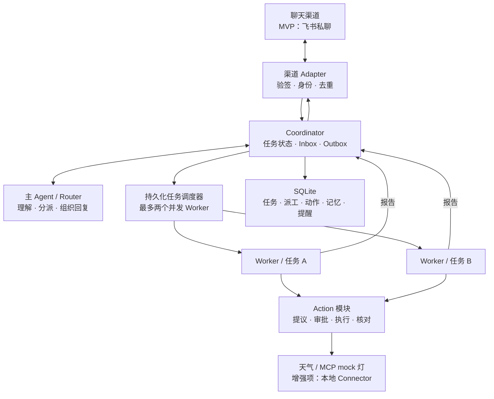

# Personal Agent

> **多端与跨平台规划（2026-11-14）**：长期支持 macOS（Apple Silicon / Intel）和 Windows 11 x64 的 CLI / TUI / Desktop，采用一个 Agent Core + 统一 Client API，而非多套独立任务状态。详见 [10 · 跨平台客户端规划](docs/10-client-platforms.md)。这仍是待实施目标，当前服务端可用性以本文下方现状为准。

> **长期规划更新（2026-11-14）**：当前唯一工程主线为 v0.2 Reliable Core。完整的长期自用与开源规划见 [07 · 长期路线图](docs/07-long-term-roadmap.md)，评测门槛见 [08 · Evaluation](docs/08-evaluation.md)，开源与部署见 [09 · Open-source](docs/09-open-source-plan.md)，宿主选型见 [ADR-0001](docs/adr/0001-runtime-hosting.md)。这份规划不代表功能已经完成，下面的“当前阶段”仍为事实基线。实施任务以 GitHub Issues 为准。


> 聊天软件里的个人助手：一个主 Agent 协调多个任务 Worker，云端持续运行，本地按授权执行，结果回到原对话。

**当前阶段：本地飞书私聊已通过长连接稳定接入；Cloudflare Worker 已部署，但飞书侧仍走本地长连接。** 本地 Node 服务具备飞书验签/解密、持久 Inbox/Outbox、主人白名单和确定性命令。2026-11-09（UTC+8）完成真实飞书 p2p 收发：入站 `om_x100b603e0219c0a0b1e2434fa552a87` 受理，出站 `om_x100b603e03ccbca4c1ec6d3785d2599` 被平台接受；webhook 与长连接均验证，当前使用 `FEISHU_EVENT_MODE=long_connection`，无需公网 URL。Cloudflare DO 已把 `pa_*` 迁移到 DO SQLite，并接入 webhook、Router/Worker、Task/Assignment、审批/动作执行、一次性提醒和显式记忆；`wrangler dev` 已通过真实模型 Router → Worker 任务。Worker 已部署到 `personal-agent.3103148441.workers.dev`，但飞书后台保存该请求地址仍超时，因此 Worker 侧云端事件入口（自定义域或 WS 桥接）与对象驱逐恢复仍未完成。

## 当前实现

| 模块 | 已实现 | 边界 |
| --- | --- | --- |
| 飞书入口 | 真实 p2p 回调、签名/Token 校验、URL challenge、主人白名单；本地长连接已连上 Feishu | 本地 webhook 用临时 Tunnel；Worker 的 workers.dev 地址在飞书后台保存时超时，云端需自定义域或 WS 桥接 |
| Inbox | `channel + account + message_id` 唯一，重复事件返回原受理 | 已接 Router；真实 p2p `/status` 已受理 |
| Outbox | 业务键唯一、按 task 分组排序、租约、重试、unknown、崩溃后按业务键核对 | 真实平台已接受 `om_`；无查询接口时保持 unknown |
| Router | 确定性命令优先；模型 JSON 决策；补充/回答、修改、提醒列表/取消、任务前缀解析 | 真实模型质量需重复评测 |
| Task / Assignment | Task 状态机、Mandate、revision、租约、fencingToken、心跳、最多两个 Worker | 10 分钟 assignment lifetime；长任务跨轮恢复需真实部署验证 |
| 审批 / 动作 | 参数绑定、nonce、一次性消费、原子审批、执行器、取消/修订后拒绝重试、unknown/reconcile、mock 灯 | mock 灯是程序化工具；MCP 桥接与真机未接 |
| 提醒 / 记忆 | 一次性提醒、runKey、TTL、聊天取消/列表；显式记忆查改删 | 周期提醒与语义检索未做 |
| 本地服务 | `POST /webhooks/feishu`、`GET /healthz`、Node SQLite | 本地进程无模型运行时，模型任务明确失败 |
| Cloudflare DO | `Assistant` + PiHarness + Lifecycle、DO SQLite 中的 `pa_*`、webhook、jobs | 已真实部署；飞书回调入口超时待解；驱逐恢复未验证 |
| 本地真实模型 | `opencode-go/deepseek-v4.1-flash`，本地 key | 单会话与三会话并发通过 |
| Cloudflare DO 运行 | 真实部署 + 真实模型 | `/healthz`、`/admin/*` 鉴权、`/ask` 真实模型通过；飞书侧未切到 Worker |

未实现或待真实环境验证：对象驱逐恢复、Worker 的飞书回调稳定入口（自定义域；长连接目前只在本地 Node）、MCP 灯桥接与真机、天气工具、budget 上限、40 条场景与真实模型重复统计。

```bash
npm install
npm test
npm run typecheck
cp .env.example .env   # 填入飞书应用凭据与主人 open_id
npm start
```

默认数据库为 `./data/agent.sqlite`；`OWNER_FEISHU_OPEN_ID` 是显式操作员绑定，不从昵称或消息正文推断。

**2026-11-09 验证：**

- **真实飞书 p2p**：入站 `message_id=om_x100b603e0219c0a0b1e2434fa552a87` 受理；回调 `POST /webhooks/feishu` 200，约 13ms；主人 `ou_48fabf7749a25c7ef394de573e94d8cf` 绑定；出站 `platform_message_id=om_x100b603e03ccbca4c1ec6d3785d2599` 被平台接受，端到端约 2s。当前走本地 Node 长连接（`FEISHU_EVENT_MODE=long_connection`），无需 Tunnel；长连接事件日志为 `feishu_ws_event`，出站 `om_x100b60141b58d0a0ddb7d24898d4134`。
- `npm test`：106 个确定性测试通过，覆盖 Inbox/Outbox、Task/Assignment fencing/心跳、原子审批、取消后 reconcile 拒绝执行、unknown→reconcile、提醒 runKey/TTL/聊天取消、显式记忆和 K05/K06/K09。
- `npm run typecheck` 与 `npm run deploy:dry-run` 通过。
- `wrangler dev`：`/webhooks/feishu` 受理 `200`，同 `message_id` 重推返回 `duplicate`；`/admin/status` 无 token `401`、有 token `200`；`/ask` 真实模型返回 `DO_OK`。
- `wrangler dev`：`/remind` 创建提醒、`/reminders` 列表、`/cancel-reminder` 取消均通过；超过 1 MiB 的 webhook body 返回 `413`。
- `wrangler dev` 真实模型任务：Router 创建任务，Worker 返回结构化报告，Task 状态变为 `succeeded`；结果 Outbox 因本地测试指向不可达飞书地址而按重试策略失败。

## 产品方向

你在飞书、微信或 QQ 里与同一个助手交流。它能整理资料、查询天气、记住明确偏好、安排提醒；长任务后台执行时，仍可接收你的新要求、补充和取消指令。会改变外部状态的动作先确认，再由程序执行。

**首发默认：飞书应用机器人私聊。** 第一版只接一个渠道；微信、QQ 后续通过独立 Adapter 接入。Web 降为管理与排查入口。

参考 [dsh-superagent-prototype](https://github.com/deepseek-ai/dsh-superagent-prototype) 的任务授权、独立 Worker 会话、并发限制和持久化消息投递思路。产品对外保持一个助手身份，MVP 内部最多运行两个任务 Worker。

## 目标架构



主选技术栈为 TypeScript + Pi Durable + Cloudflare Durable Object / Lifecycle。一个用户的多个独立会话能否满足并发与恢复要求，是第一阶段验证项。模型先接一个；存储先用 SQLite；不把 D1、Vectorize、完整 Web UI 或多模型路由设为首版依赖。

## MVP 与实施顺序

| 阶段 | 交付 |
| --- | --- |
| 前三个工作日 | 真实聊天收发、回调、云端多会话恢复验证；明确主选或替代路线 |
| 第 1 周 | 渠道 Adapter、持久 Inbox/Outbox、真实模型、首批关键回归 |
| 第 2 周 | Task / Assignment、两个 Worker、人工输入优先、修改和取消 |
| 第 3 周 | mock 灯 MCP、审批、幂等执行、结果不确定时的核对 |
| 第 4 周 | 一个持久提醒、显式偏好记忆、开始日常使用；有余量接真实灯 |
| 第 5–6 周 | 扩展评测、修复失败、最小管理页、演示与交付缓冲 |

六周是工作预算，不承诺在恢复或审批未过关时继续加功能。技术门槛、统一替代规则和每周验收以 [构建计划](docs/04-build-plan.md) 为准。

首版验收：**一个真实聊天渠道中，两项任务并发且可以补充/取消；一次受控写操作可审批、核对与审计；关闭客户端和重启后，提醒仍能发送。** mock 与真实设备证据分别标注。

## 文档导航

| 文档 | 用途 |
| --- | --- |
| [00 · 产品规划](docs/00-product-plan.md) | 场景、首发渠道、MVP、后置能力与 DSH 借鉴 |
| [领域术语](CONTEXT.md) | Task、Assignment、Mandate、Action、Approval 的含义 |
| [02 · 架构](docs/02-architecture.md) | 模块职责、调度、消息投递、审批、恢复与数据模型 |
| [04 · 构建计划](docs/04-build-plan.md) | 技术门槛、六周里程碑、评测和交付标准 |
| [06 · 下一步与操作手册](docs/06-next-steps-and-runbook.md) | 待办、飞书/DO/模型操作与故障处理 |
| [Cloudflare DO](infra/README.md) | Durable Object、Lifecycle、PiHarness 与部署限制 |
| [01 · 可行性资料](docs/01-feasibility.md) | 原始技术调研；产品决策以 00/02/04 为准 |
| [03 · 岗位适配](docs/03-job-fit.md) | 项目证据与岗位要求；规划不能写成已实现 |
| [05 · JD 附录](docs/05-jd-appendix.md) | 原始岗位样本，不作为功能清单 |
| [本地 spike](spikes/pi-durable-smoke/README.md) | Pi 本地验证与证据边界 |

## 已有 spike

```bash
cd spikes/pi-durable-smoke
npm install
npm run smoke
npm run kill
npm run multi
npm run real
npm run real:multi
```

`multi` 在同一个 Harness 中创建 Router 与两个 Worker：Worker A 阻塞在工具时，Router 仍能回复、Worker B 仍能完成，三份 context 不含其他会话输入。它使用 faux provider 和单进程，只证明本地 Pi 会话语义，不证明 Cloudflare DO 或真实模型行为。

`real` 和 `real:multi` 读取仓库根目录 `.env` 的 `OPENCODE_API_KEY`，调用真实的 `opencode-go/deepseek-v4.1-flash`。已实测单会话返回 `PA_REAL_MODEL_OK`，三会话并发返回 `ROUTER_REAL_OK` / `WORKER_A_REAL_OK` / `WORKER_B_REAL_OK`，且上下文互不串扰。`.env` 不入库。

仓库记录的环境：Node 26.12.0，Pi Durable 1.5.0，faux provider，无需 API key。`smoke` 输出关键字段：

```json
{
  "executed": false,
  "entryCount": 5,
  "reopenedEntryCount": 5,
  "sameRoot": true
}
```

`kill` 让子进程提交一轮会话后等待，父进程用 `SIGKILL` 终止并重新打开同一 SQLite 文件：

```json
{
  "killedWith": "SIGKILL",
  "entryCount": 2,
  "reopenedSameRoot": true
}
```

两个脚本现已对上述字段逐项断言。它们演示了工具调用被 beforeTool 拦截，以及已提交会话在正常关闭和独立进程被杀后仍可重新打开。

它们没有验证真实模型、未完成任务/待审批状态的运行中恢复、完整审批后执行、多个 Worker、云端部署或聊天通知。`kill` 用例只证明已提交 transcript 的持久性，不能替代“任务执行中中断后恢复”的门槛实验。
