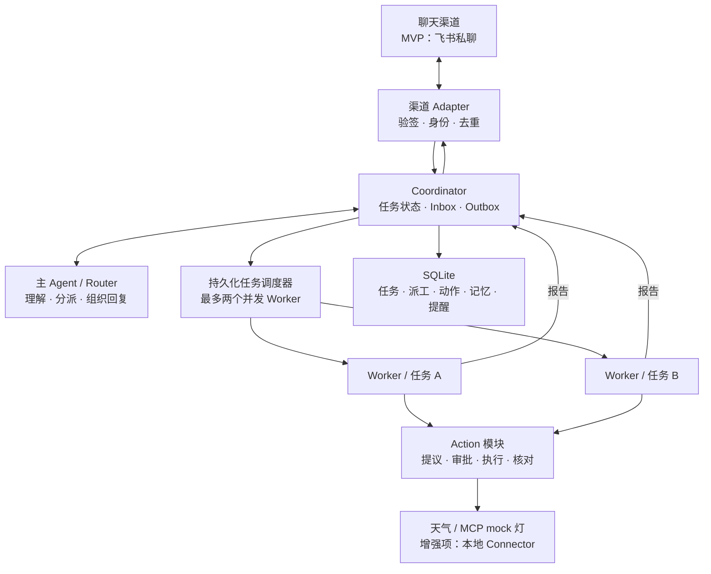

# Personal Agent

> 聊天软件里的个人助手：一个主 Agent 协调多个任务 Worker，云端持续运行，本地按授权执行，结果回到原对话。

**当前阶段：规划与可行性验证。** 现有可执行代码只有一个 Pi Durable 本地 spike；聊天渠道、多 Agent 调度、云端部署、真实审批和通知尚未实现。仓库记录了旧 spike 的结果，本轮文档整理未重跑该脚本。

## 产品方向

你在飞书、微信或 QQ 里与同一个助手交流。它能整理资料、查询天气、记住明确偏好、安排提醒；长任务后台执行时，仍可接收你的新要求、补充和取消指令。会改变外部状态的动作先确认，再由程序执行。

**首发默认：飞书应用机器人私聊。** 第一版只接一个渠道；微信、QQ 后续通过独立 Adapter 接入。Web 降为管理与排查入口。

参考 [dsh-superagent-prototype](https://github.com/deepseek-ai/dsh-superagent-prototype) 的任务授权、独立 Worker 会话、并发限制和持久化消息投递思路。产品对外保持一个助手身份，MVP 内部最多运行两个任务 Worker。

## 目标架构



主选技术栈为 TypeScript + Pi Durable + Cloudflare Durable Object / Lifecycle。一个用户的多个独立会话能否满足并发与恢复要求，是第一阶段验证项。模型先接一个；存储先用 SQLite；不把 D1、Vectorize、完整 Web UI 或多模型路由设为首版依赖。

## MVP 与实施顺序

| 阶段 | 交付 |
| --- | --- |
| 前三个工作日 | 真实聊天收发、回调、云端多会话恢复验证；明确主选或替代路线 |
| 第 1 周 | 渠道 Adapter、持久 Inbox/Outbox、真实模型、首批关键回归 |
| 第 2 周 | Task / Assignment、两个 Worker、人工输入优先、修改和取消 |
| 第 3 周 | mock 灯 MCP、审批、幂等执行、结果不确定时的核对 |
| 第 4 周 | 一个持久提醒、显式偏好记忆、开始日常使用；有余量接真实灯 |
| 第 5–6 周 | 扩展评测、修复失败、最小管理页、演示与交付缓冲 |

六周是工作预算，不承诺在恢复或审批未过关时继续加功能。技术门槛、统一替代规则和每周验收以 [构建计划](docs/04-build-plan.md) 为准。

首版验收：**一个真实聊天渠道中，两项任务并发且可以补充/取消；一次受控写操作可审批、核对与审计；关闭客户端和重启后，提醒仍能发送。** mock 与真实设备证据分别标注。

## 文档导航

| 文档 | 用途 |
| --- | --- |
| [00 · 产品规划](docs/00-product-plan.md) | 场景、首发渠道、MVP、后置能力与 DSH 借鉴 |
| [领域术语](CONTEXT.md) | Task、Assignment、Mandate、Action、Approval 的含义 |
| [02 · 架构](docs/02-architecture.md) | 模块职责、调度、消息投递、审批、恢复与数据模型 |
| [04 · 构建计划](docs/04-build-plan.md) | 技术门槛、六周里程碑、评测和交付标准 |
| [01 · 可行性资料](docs/01-feasibility.md) | 原始技术调研；产品决策以 00/02/04 为准 |
| [03 · 岗位适配](docs/03-job-fit.md) | 项目证据与岗位要求；规划不能写成已实现 |
| [05 · JD 附录](docs/05-jd-appendix.md) | 原始岗位样本，不作为功能清单 |
| [本地 spike](spikes/pi-durable-smoke/README.md) | 唯一已有运行原型及其证据边界 |

## 已有 spike

```bash
cd spikes/pi-durable-smoke
npm install
npm run smoke
```

仓库记录的环境：Node 26.12.0，Pi Durable 1.5.0，faux provider，无需 API key。输出包括：

```json
{
  "executed": false,
  "entryCount": 5,
  "reopenedEntryCount": 5,
  "sameRoot": true
}
```

原脚本分两次输出，上面仅合并列出关键字段。它演示了工具调用被 beforeTool 拦截，以及任务结束后关闭运行时、重新打开同一 SQLite 文件时会话记录仍在。脚本主要打印结果，尚未对这些字段逐项断言。

它没有验证真实模型、运行中进程崩溃恢复、完整审批后执行、多个 Worker、云端部署或聊天通知。下一步应补独立进程故障注入与状态断言，再扩展产品能力。
