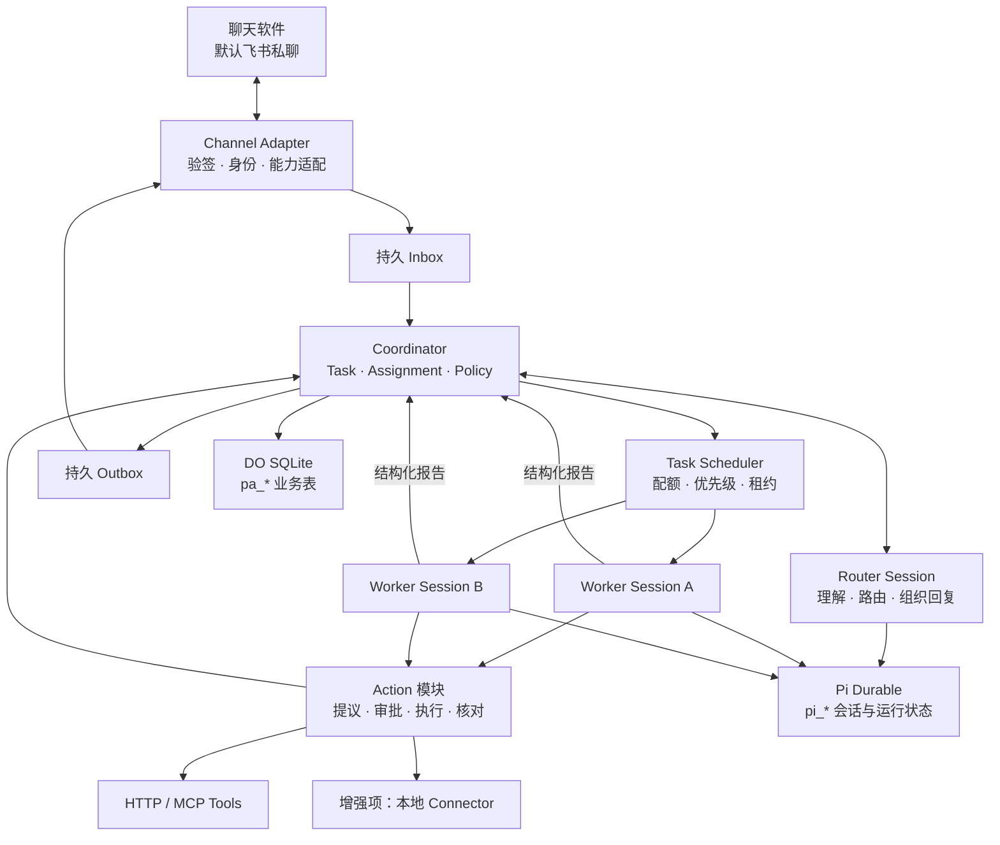
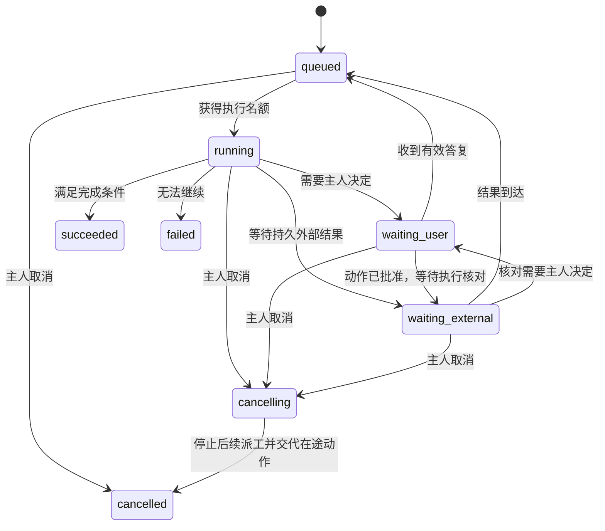
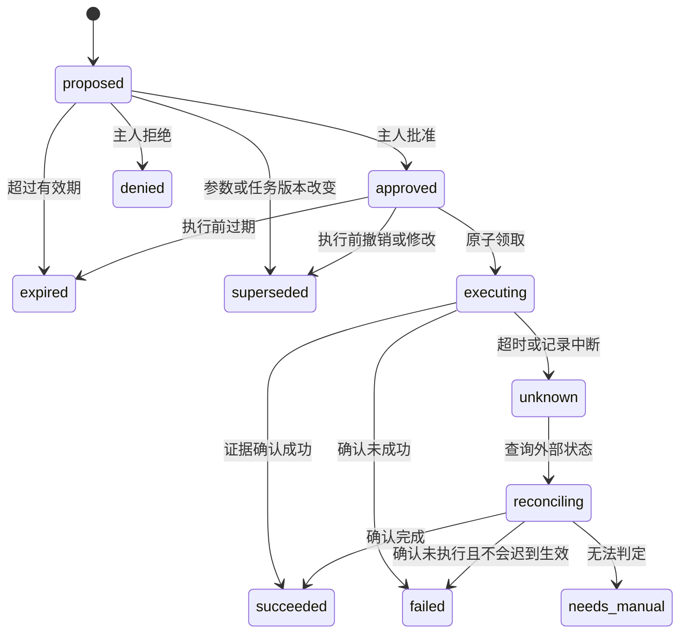

# 02 · 架构与可靠性设计

> **2026-11-14 架构续篇**：原有状态机与授权设计继续保留。运行中补充输入的 input_seq/消费序号、执行前授权、非阻塞调度、按任务类型完成验证和组件化部署，详见 [07 · 长期路线图](07-long-term-roadmap.md) 及 [08 · 评测契约 K13/K14](08-evaluation.md)。Node/Cloudflare 唯一默认宿主尚未决定，见 [ADR-0001](adr/0001-runtime-hosting.md)。
> **2026-11-17**：运行中补充输入已按 K13 落地（不可变 `pa_task_inputs`、Assignment 输入序号与旧报告屏障；含 `failed` 报告）；K14 执行前授权已按 PA-03 落地（E1），真实写工具与平台审批点击仍未验证。


> 2026-11-09 修订。本文是目标设计；Week 1 的本地入口/投递骨架与 Week 2–4 的独立代码（Router/Worker、Task/Assignment、审批/执行、提醒、显式记忆、DO `pa_*`）已实现并通过本地确定性测试（见 [README](../README.md)）。真实飞书 p2p 回调与主动回复已通过本地 Node（webhook + 长连接）验证；Cloudflare Worker 已真实部署；飞书侧稳定入口与对象驱逐恢复仍未验证。产品范围以 [00](00-product-plan.md) 为准，交付门槛以 [04](04-build-plan.md) 为准，术语以 [CONTEXT.md](../CONTEXT.md) 为准。

## 1. 架构约束

- 单主人、一个首发聊天渠道，MVP 仅主人私聊；默认飞书应用机器人。
- 一个逻辑主 Agent / Router，最多两个并发任务 Worker；先用一个真实模型。
- 业务 Task 是获准的工作，Assignment 是一次派工，Action 是具体状态变更；均不同于 Pi 内部的模型/工具 task。
- Router 做意图理解与协调；Coordinator 的代码决定状态、授权、并发、预算和投递。
- Worker 有独立上下文与工具范围，只能提议写动作；ActionExecutor 是程序，不是另一个模型 Agent。
- 收到消息先持久化，回调不等待模型生成；发信、派工、执行动作先入持久队列。
- 关键测试从第一周建立；完整 Web 聊天、多模型、向量记忆和任意桌面控制后置。

## 2. 总体结构



部署主选：一个主人一个 Durable Object，Lifecycle 统一管理 PiHarness 与应用待办的唤醒。Router 与每个 Task 使用独立 Pi session；它们是独立派工，不假定默认 subagent 的父子生命周期能满足跨轮长期任务。

**待验证**：单 DO 多 session 的实际启动方式、并发模型请求、停止传播与恢复行为。DO 的 JavaScript 单线程不等于异步操作不会交错；关键状态变更仍需事务和条件更新。若单 DO 多 session 不能满足验收，按构建计划门槛先评估按任务拆 DO 或替换运行时，不能仅因能创建会话就宣布并发成立。

MVP 不需要 D1 / Vectorize；大输出先限制长度，完整材料只在需求成立时放 R2 或其他附件存储。

本轮技术门槛统一在前三个工作日形成结论，具体实验和替代规则见 [04](04-build-plan.md)。

## 3. 模块与 Interface

| Module | 负责 | 对外结果 |
| --- | --- | --- |
| Channel Adapter | 平台验签/解密、身份与会话定位、回调归一化、发送、平台回执 | Trigger / DeliveryReceipt |
| Coordinator | 唯一业务状态写入口；接收、路由、派工、修改、取消、汇总 | Task 状态、持久 Effect |
| AgentRuntime Adapter | 独立会话、幂等输入、快照、订阅、中断 | 模型输出和 Worker 报告 |
| Action 模块 | 权限、参数绑定、审批、原子领取、执行和核对 | Action 状态与审计 |
| Tool Adapter | 具体 HTTP / MCP / 本地命令；声明超时与重放性质 | 有界、带来源的工具结果 |
| Outbox | 按原对话交付确认、问题、结果和提醒 | 平台接受、失败或待核对 |

这些是同一应用内的职责划分，不要求拆成独立服务或多个 npm 包。内部调度器、提醒和显式记忆由 Coordinator 组合，初期不增加通用插件框架。

### 3.1 运行时接口草案

以下是本项目的概念接口，不是 Pi SDK 的现成 API；具体调用在技术 spike 中验证：

```ts
interface AgentRuntime {
  openSession(spec: SessionSpec): Promise<SessionRef>;
  submit(input: SessionInput): Promise<SubmissionReceipt>;
  snapshot(sessionId: string): Promise<SessionSnapshot>;
  watch(sessionId: string): AsyncIterable<SessionSnapshot>;
  interrupt(sessionId: string): Promise<InterruptReceipt>;
}
```

SessionSpec 包含稳定 sessionId、角色和工具范围；SessionInput 包含稳定 deliveryId 与业务版本。调用方必须能查询提交是否被接受，并在重试时使用同一个 deliveryId。

审批不属于 AgentRuntime。任务取消先在应用状态中生效，再请求中断；运行时忽略中断不能重新获得已撤销的动作执行权。

接口隔离降低替换成本，但不承诺已有会话格式自动迁移，也不提前实现第二套运行时。

### 3.2 工具接入

- 天气先用 HTTP Tool Adapter，mock 灯用 MCP Adapter，形成两个可运行实现。
- Pi Durable 的工具 registry 与 MCP client 之间需要桥接；CLI 的 MCP 配置不等于 Pi Durable 已经集成 MCP。
- 每个工具声明参数 schema、允许资源、只读/写、超时、输出上限、重放策略与核对方法。
- 工具描述和结果是外部数据；不能充当系统指令、身份、授权或审批依据。
- 模型可调用只读工具和 propose_action；外部写工具不直接注册给模型。
- 只读默认也要限制资源与输出；访问个人资料不因“只读”就自动获得权限。

## 4. 聊天事件、身份与投递

### 4.1 入站流程

1. Channel Adapter 验证平台请求，完成必要解密，并拒绝未绑定主人或非首发允许对话。
2. 归一化 Trigger：channel、account、conversation、actor、platformEventId、replyTo、eventType、occurredAt、payload。
3. 以 channel + account + platformEventId 唯一约束写入 pa_inbox，保存路由待办；重复事件返回原受理状态。飞书消息事件的 platformEventId 使用 `message_id`，因为同一条消息可能以不同 `event_id` 重复推送。
4. 提交成功后尽快确认平台回调；耗时模型工作异步进行。平台 challenge、卡片即时应答按各自协议独立处理。
5. 用程序先识别确定的卡片操作、任务状态查询和取消，再把需要语义理解的输入交 Router。
6. Router 的路由命令仍由 Coordinator 验证任务归属、版本和 Mandate。

不以昵称、消息正文或模型推断识别主人。未来跨平台身份绑定需要带外验证；群聊单独保存上下文，个人记忆不自动注入群聊。

### 4.2 后续消息归属

优先使用卡片中的 taskId / actionId、原消息引用与已保存的任务回执映射。自然语言可由 Router 提议路由，但目标不明确或会扩大权限时必须澄清。

- 补充事实：追加不可变 TaskInput（按 task 单调 `seq`），派工时记录 `dispatched_input_seq`；Worker 报告必须覆盖已派发输入，运行中到达的新输入使任何旧报告（含 `failed`）失去推进资格并重新派工。
- 修改目标/限制：增加 Task revision，使尚未发送的旧动作与旧审批失效，结束旧 Assignment 后重新派工。
- “先处理另一件事”：调整待派工顺序；不能默默取消已经发生的外部操作。
- 普通致谢/闲聊：无需创建新 Task。

### 4.3 Outbox

每条消息记录 owner、conversation、taskId、purpose、businessKey、payload、attempts、nextAttemptAt、platformMessageId。目的限制为接单、澄清/审批、结果、失败或已授权提醒。

- 在记录状态的同一事务中创建 Outbox / Effect；网络调用在提交后执行。
- 同一任务到同一对话保持接单、问题、结果的顺序；不同任务不因一个会话失败而全部停止。
- 发送前重查 Task revision、接收人、提醒取消状态及有效期。
- 平台返回接受结果才标为 accepted；有送达/已读回执时另记 delivered/read。
- 超时但可能已经发送时进入 delivery_unknown：有平台幂等键则复用，能查询则核对，否则记录重复风险并按消息类型决定是否重发。不能声称 Outbox 本身保证 exactly-once。
- 平台不支持卡片时，降级为展示明确参数并绑定唯一动作编号的文本确认，不接受无对象的“同意”。

MVP 默认一次接单，之后只在完成、失败、需决定或约定提醒时发信；普通进度可通过任务查询查看。平台流式编辑是增强项，不强求逐 token 消息。

## 5. Task、Assignment 与调度

### 5.1 Task 状态



等待时必须能保存恢复所需信息，不持有内存 Promise 等主人。后台命令或模型调用仍在运行时不能仅改个 waiting 状态就释放执行名额。

Task 字段至少包括：owner、conversation、goal、completionCriteria、Mandate、revision、status、priority、deadline、budget、resultRef。Mandate 说明允许的资料、工具与目标；工具结果和 Worker 报告不能扩张它。

### 5.2 Assignment 与报告

一次 Assignment 绑定 taskId、taskRevision、sessionId、attempt、leaseUntil、fencingToken、`dispatchedInputSeq` 和 `consumedInputSeq`。领取用事务/条件更新，防重复派工。恢复或改派增加 fencingToken；旧 Worker 的报告与动作提议在写入口被拒绝。

派工时把当前最新 input seq 写入 `dispatchedInputSeq`，Worker prompt 只注入 `seq <= dispatchedInputSeq` 的输入。报告进入状态推进前重新读取当前最新 seq；若高于派工快照，任何报告（含 `failed`）都不能推进任务，而是回到 `queued` 重新派工，旧报告也不得提出动作。这样即使效果重试、进程重启或旧 Worker 延迟返回，补充输入不会被静默跳过。

Worker 使用结构化 Report：working / waiting_user / waiting_external / ready / failed，附摘要、证据、待决定问题和费用。Coordinator 核对完成条件后决定 Task 状态；仅“模型说完成”不算验收。

Worker 不相互广播上下文，也不直接向聊天平台发信。跨任务信息先成为主 Agent 可核对的摘要，再按授权范围提供给另一任务。未实现嵌套 Worker 和通用任务 DAG。

### 5.3 名额与人工输入

- 最多两个活跃 Worker，Router 不占 Worker 名额；总模型请求并发初值为三，工具并发另设硬上限。
- 给 Router 留一个模型请求预算；人工状态查询和明确取消优先走程序路径，不等 Worker 结束。
- 用户补充、取消和状态请求优先于新后台任务；不通过无限增开 Worker 来实现优先级。
- 模型等待按短切片轮询（Assignment 100ms、Router 250ms），pending 用有界退避重试；单个长生成不能占住 Effect drain，Worker 名额仍为 2。
- 短只读查询可在 Router 完成；其工具也受总预算与超时限制。
- 只有 Worker 真正空闲且没有在途后台工作才释放名额；等待审批后由程序调度执行 Action，完成后排队唤醒 Worker。
- 确定性巡检发现租约过期、超时或预算超限后记录事件并处理；首版不增加模型 Watchdog。

### 5.4 修改与取消

取消先原子更新任务授权状态、revision，作废未发送的派工/动作和尚未交付的旧结果，再请求运行时中断。恢复后仍能看到撤销记录，旧回调不能复活任务。

不能撤回已经发出的外部请求；用户取消时如果有在途动作，显示“停止后续执行，正在核对在途结果”，继续对该动作核对和审计。任务取消不等于物理效果被撤销；补偿也是一个新的受控动作。

## 6. 审批、执行与结果核对

### 6.1 明确区分三种权限

| 类型 | 授权方式 |
| --- | --- |
| 范围内只读与资料整理 | Task Mandate + 工具资源校验 |
| 记忆保存、一次性提醒 | 主人的明确请求 + 展示确认后的内容/时间/接收人；程序记录授权依据 |
| 灯控制等外部写动作 | 固定参数的 Action + 主人明确审批；再执行 |

给当前主人回信及发送其已确认的提醒走受限 Outbox，不为每条结果消息再次弹审批。任意第三方外发、支付、门锁等能力不注册。

### 6.2 Action 状态



Action 使用不可变的工具名、规范化参数、argsHash、owner、conversation、taskRevision、fencingToken、expiresAt 和 nonce。改参数必须新建 Action，不能复用旧审批。

审批卡片仅携带不透明引用，服务端校验平台来源、点击者身份、绑定对话、动作参数与版本。approved → executing、一次性审批消费和执行待办创建在同一事务内完成。执行器发送前再校验当前授权；模型拿不到审批凭据。

执行前重核（PA-03）在 claim 的同一事务内重新读取 `pa_tasks`：owner、conversation、taskRevision 必须与 Action 一致，Task 不得是 `cancelled`/`cancelling`/`succeeded`/`failed`，且当前 Mandate 仍包含该工具。校验失败或审批已过期时，Action 转为 superseded/expired、消费一次性审批并记录 `action.execution_rejected`，绝不调用 `tool.execute`。审批入口也做同一重核，防止任务结束后再用旧审批卡片批准；执行中的外部请求仍按 unknown → reconcile 处理，不假装物理撤销。

纯服务端审批先依赖平台验签、主人身份和持久状态，不把自建 OAuth / Passkey 作为首版任务。本地命令需要签名和重放保护，见 §8。

### 6.3 外部成功与本地落库之间的窗口

典型故障：设备已接受命令，程序尚未记录成功就崩溃。恢复后不能将其当作普通失败并盲目重试。

1. 过期执行租约进入 unknown，保留原 actionId 与尝试记录。
2. 优先按外部幂等键或操作回执查询。
3. 对绝对值设定可读取设备状态；如果只能证明“目标状态已满足”，如实记录，不能据此证明是哪次调用改变了状态。
4. 只有工具能证明重复执行安全、授权仍有效时，才允许同 actionId 重试；旧请求仍可能迟到时不得认定“未执行”。
5. 无法核对时进入 needs_manual，报告已知事实与后续选择。

check-before-write、幂等键和本地命令缓存各自不能消除所有崩溃窗口。MVP 使用可核对的 mock 灯覆盖这些路径，真实设备测试单独报告。

## 7. 持久工作、恢复与调度

应用状态转移、待执行 Effect 和审计在同一事务写入；执行端不在数据库事务中等待模型或网络。Effect 使用稳定 businessKey，记录租约、次数、下次运行时间和结果，提交后领取执行。

| 工作 | 重复/中断后的规则 |
| --- | --- |
| 入站消息 | 唯一事件键，已接受事件返回原受理状态 |
| 向会话交付 Input | 稳定 deliveryId，查询已接受状态，再决定补投 |
| 派工与报告 | taskRevision + fencingToken，过时结果不推进任务 |
| 模型生成 | 按运行时策略恢复，记录可能重复的 token 与费用 |
| 只读工具 | 有界重试；明确工具确实可重放后才声明 safe |
| 写动作 | 已知安全才重试；可能生效的中断进入 unknown |
| 聊天发送 | 平台幂等/查询优先；结果不明时单独核对与记录风险 |
| 定时任务 | scheduleId + scheduledAt 唯一 runKey，防重复创建业务任务 |

Pi 自己的会话 checkpoint 与应用 pa_* 表不是天然的同一个事务。通过持久 Input / Effect 与运行时幂等交付对接，不假设“两边一起提交”。新 Runtime Adapter 必须通过同一组交付和恢复契约测试。

Lifecycle 统一拥有底层 alarm；Pi 唤醒、应用 Effect、提醒与租约检查都使用同一生命周期调度。DO 只有一个 alarm，不能另写一个业务 alarm 覆盖 Pi 的唤醒。

恢复顺序：加载撤销/当前版本 → 恢复到期 Effect 与未知动作 → 核对旧派工 → 补投有效输入 → 重新订阅运行时视图。最终交付前再次检查版本。外部 I/O 的错误要区分“未发送”“明确拒绝”“结果未知”。

## 8. 本地 Connector（增强项）

主选最少代码的 Tunnel + Access 服务认证路径；仅暴露受保护的工具入口，绑定本机 loopback。Workers VPC 或自建 outbound WSS 在有实际需求后评估，不同时开发三种传输。

若使用 MCPClientManager，注意其 private/internal URL 限制；VPC 需验证自定义 transport/binding。Access service token 是机器认证，不当成 MCP OAuth 授权服务器。

命令信封包含 commandId、actionId、taskRevision、工具/参数、deadline、签名和 nonce。Connector 校验能力白名单、签名、有效期，持久记录命令和结果；重启后重复 actionId 查询原记录。签名密钥和设备凭据只由程序持有，不能依靠模型生成授权。

撤销在命令发送前阻止旧动作；已到设备的请求仍有不可撤回窗口，Connector 也要支持 unknown / reconcile，不声称本地去重表等于 exactly-once。离线命令不得无限排队，恢复后重查 TTL 与授权。

米家社区 MCP 可能仍调用小米云 API；“Connector 在本地”不代表“局域网直连”。先 mock、后真机。首版不接 macOS GUI、门锁、摄像头或任意 Shell。

## 9. 提醒、记忆与隐私

### 9.1 提醒

Schedule 保存主人、时区、具体时间、任务模板、接收对话、有效期和授权。MVP 先支持一次性提醒；周期提醒后置，不能把确认一次的频率擅自扩大。

默认 Asia/Shanghai，但以主人设置为准。创建时返回实际执行时间供确认。错过提醒按 TTL 处理：有效期内补发一次，过期记录 skipped 并可查询；不在重启后补发全部积压消息。静默时段与例外在创建时说明。

### 9.2 显式记忆

SQLite 保存主人明确提供的偏好/事实、sourceEventId、更新时间与当前有效版本。提供“查看记忆 / 修改 / 忘记这条”的聊天操作。

Worker 只读取当前任务需要的记忆；第三方资料和模型推测不自动写入。先做结构化匹配，语义检索与自动抽取等有失败证据再增加。

### 9.3 数据与密钥

Provider、平台和 Connector 凭据由运行环境 secret 管理；模型上下文与日志不包含凭据。日志记录必要 ID、状态、耗时、费用和错误类别，内容按需脱敏。

MVP 只承诺删除应用记忆。Pi conversation 的删除能力有限，完整历史清除/保留策略需单独验证和实现，不能用“忘记偏好”冒充“清除所有数据”。导出、备份和恢复结果需有单独记录。

## 10. 应用数据模型

所有表用 pa_ 前缀，不直接改写 Pi 的 pi_* 表。下表是字段与约束草案，不是已执行 migration。

| 记录 | 核心字段与约束 |
| --- | --- |
| pa_identities / pa_conversations | 主人、平台账号/用户 ID、对话地址、绑定证据；禁止昵称匹配 |
| pa_inbox | 唯一 channel/account/eventId、actor、replyTo、状态、原始载荷引用 |
| pa_tasks | 主人、对话、goal、completionCriteria、Mandate、revision、状态、预算 |
| pa_task_inputs | taskId、单调 seq、kind、sourceInboxId、actor、正文、时间；同一任务+来源幂等，不可修改 |
| pa_assignments | taskId、taskRevision、sessionId、attempt、租约、fencingToken、dispatched/consumed input seq、Report；同任务至多一个有效派工 |
| pa_actions / pa_approvals | 不可变参数、hash、任务版本、批准人、nonce、有效期、一次性消费、执行证据 |
| pa_effects | kind、唯一 businessKey、payload、状态、租约、重试次数、nextAttemptAt |
| pa_outbox | 任务/提醒版本、目的、接收地址、业务键、平台消息 ID、投递状态 |
| pa_schedules | 具体时间、时区、模板、接收地址、TTL、状态；每次运行使用唯一 runKey |
| pa_memories | 主人、key/value、来源、版本、有效/删除状态 |
| pa_audit | 主体、事件、任务/动作、before/after 摘要、traceId、时间 |

提醒执行的唯一 runKey 同时约束任务/Effect 创建；重复 alarm 不创建第二份任务。报告与审计保留过时记录，但它们不能改变当前任务状态。

## 11. 代码组织与技术选择

建议最初只保留一个 Agent 应用和少量模块；有真实复用时再拆包：

```text
apps/agent/src/
  channels/           # 飞书 + 测试用 fake
  coordinator/        # Task / Assignment / Policy / Scheduler
  runtime/            # Pi Adapter
  actions/            # propose / approve / execute / reconcile
  tools/              # weather HTTP / mock lamp MCP
  delivery/           # Inbox / Outbox / Effects
  personal/           # 显式记忆 / 一次性提醒
  storage/            # pa_* migration 与查询
evals/                # TS 确定性契约、fake、任务定义和报告
spikes/               # 已有验证与下一轮技术门槛
infra/                # Wrangler、平台设置说明、部署检查
docs/
```

- 运行时：TypeScript、Pi Durable / Pi AI；当前 spike 固定 1.5.0，Cloudflare 集成候选 agents 0.33.0。技术门槛中确认兼容后锁定实际版本和 lockfile。
- 模型：一个真实 provider，Router / Worker 先共用，不预先做动态路由。
- 存储与托管：DO SQLite + Lifecycle 为主；替代路线只在门槛触发后实施。
- 验证：先用 TypeScript 统一确定性检查；Python、LLM judge、完整 OTel 后端按需要后置。
- 管理界面：先聊天命令，后最小 Web 管理页；不需要先搭完整 Next.js 聊天站。

## 12. 技术依据与待验证清单

原理依据：

- [Cloudflare PiHarness：独立会话、恢复、版本与限制](https://developers.cloudflare.com/agents/harnesses/pi/)
- [DO alarm：单个 alarm 与至少一次执行](https://developers.cloudflare.com/durable-objects/api/alarms/)
- [Lifecycle](https://developers.cloudflare.com/agents/runtime/lifecycle/)
- [MCPClientManager](https://developers.cloudflare.com/agents/runtime/capabilities/mcp-client-manager/)
- [dsh-superagent 领域模型](https://github.com/deepseek-ai/dsh-superagent-prototype/blob/main/docs/001-domain.md)
- [dsh-superagent 执行与恢复](https://github.com/deepseek-ai/dsh-superagent-prototype/blob/main/docs/003-execution.md)
- [dsh-superagent Effects / Outbox](https://github.com/deepseek-ai/dsh-superagent-prototype/blob/main/docs/007-architecture.md)

必须用代码验证：平台真实回调和主动发送；Pi 提交幂等与多会话；Worker 忙碌时响应新输入；进程中断后的恢复；审批重复/过期/撤销；外部已生效但未落库；消息已发送但回执未落库。版本隔离、接口名称和平台能力不能仅凭本文认定已实现。

## 13. WorkProfile 与 ExecutionStrategy 架构扩展（2026-11-17，设计提案）

长期保持**同一个** Coordinator/TaskService、Assignment、Mandate、ActionService、Scheduler、Inbox/Outbox。客户端通过 Client API 提交期望的 `WorkProfile`（general/coding/research）与 `ExecutionStrategy`（direct/delegated/organization），后端负责校验并冻结实际模式版本、工具/资源 scope 与预算。Router 可以建议策略，不能自行授权。

Coding Profile 不自动开放 Shell、文件写入或 Git push；Organization 是**后续的有界 WorkflowPlan/DAG**，由 Parent Task 受控派生有依赖、验证器、预算的工作节点；全实例 Worker 上限仍为 2；子节点权限必须是 Parent Mandate 子集；任务修订/取消后旧计划和 Assignment 通过 revision/fencing 失效，外部在途结果独立核对。

**当前没有 Mode Registry、Organization DAG 或 Coding 沙箱实现**；本节不改变 v0.2 的 Task 状态机与可靠性验收。详细领域模型、模式组合、隔离边界、恢复策略和新 MODE 测试见 [12 · Mode Architecture](12-mode-architecture.md)。

## 14. ModelPolicy、会话级模型绑定与可选 Gateway（2026-11-17）

现有架构扩展为 **WorkProfile × ExecutionStrategy × ModelPolicy**，但**只有一个 Coordinator/TaskService、Task/Assignment/Mandate、ActionService、Scheduler 和 AgentRuntime 生命周期体系**。ModelPolicy 负责根据任务角色（Router/Worker/未来 Workflow Node）、用户明确指定模型、能力需求、预算和数据出站限制解析模型；ModelTransport 使用 Direct Provider 或可选 Gateway Adapter（Magpie 等）。网关不拥有 Task/Action 权限状态，也不决定业务是否完成。

**代码现状**：`NodePiRuntimeOptions.model` 目前是 Node Runtime 级默认值；`PiRuntime.open(spec)` 尚未消费 per-Session 模型参数；Cloudflare Worker 仍有固定默认模型。因此需要先为 `RuntimeSessionSpec` 增加经服务端解析的模型绑定，分别验证 Node/Cloudflare 的 Pi 实际 API；不能把概念类型当成已实现能力。

模型应在 Assignment / Session 创建时冻结 provider/model/route、Policy 版本、能力与预算；`ModelCatalog` 和 `ModelResolver` 做可用性/工具协议/上下文/费用及授权检查。用户修订或策略热更新不能悄悄改变当前 Session。Gateway Route Group 可能在后续请求选择不同底层模型；需验证长期会话粘性，无法保证时不宣称“固定模型”，保留实际请求的模型来源未知状态。

**关键故障限制**：模型输出开始、工具调用可能已发生或请求接受状态不明时，不得把 Fallback 视为无副作用透明重试。继续遵守既有 K03、K08–K14 和 unknown/reconcile。Gateway 的出站数据和凭据需要显式授权；Cloudflare 的 loopback 不是用户本地 Mac 的 loopback。

完整领域类型、路由规则、Magpie 集成、预算、MRT 专项评测和分阶段实施见 [13 · Model Routing & Gateway](13-model-routing-gateway.md)。本节是长期架构方案，**当前 v0.2 不开发自建模型网关或自动路由算法**。
