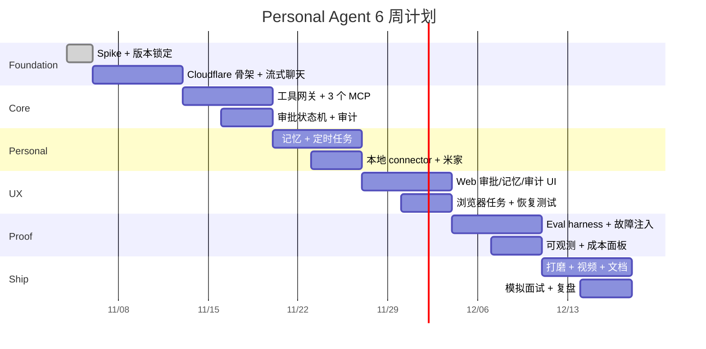

# 04 · 6 周 MVP 构建计划

> 目标：6 周内做出一个**可部署、可演示、可评测**的 personal agent 竖切，而不是一个功能很多但讲不清的 demo。每周都有可验收的产物；第 6 周必须能录 5 分钟视频。

## 1. MVP 定义

### 必须有的能力

1. **聊天 + 流式**：Web/PWA 发消息，Agent 流式回答；刷新/重连不丢。
2. **工具调用**：至少 3 类 MCP（天气、日历、米家/家庭），带超时、重试、输出上限。
3. **审批**：所有写操作走 `propose_action → approve → execute`；审批卡片展示设备/参数/风险/来源；高风险 step-up。
4. **持久化**：transcript、pending action、schedule 落 SQLite；杀 DO/重启后恢复。
5. **定时任务**：至少 2 个（早间简报、一次性提醒）；时区/quiet hours/错过策略。
6. **记忆**：至少 20 条事实/偏好；可查看/编辑/删除；检索带 provenance。
7. **本地 connector**：Mac mini/家庭服务器；Workers VPC（beta）优先，Tunnel + Access 备选；米家只读 + 1 个低风险控制。
8. **审计**：每个副作用记录 before/after、approver、trace_id。
9. **评测**：30–50 条任务；确定性 grader + LLM judge；故障注入；报告。
10. **可观测**：run/model/tool/approval/connector span；成本/延迟面板。

### 明确不做（MVP）

- 多租户、计费、团队权限；
- 任意 macOS GUI 自动化（KimiCU 只做可选、有人值守）；
- 支付/门锁/摄像头/密码管理器；
- 自训练模型；
- 复杂 Multi-Agent 自治；
- 移动原生 App。

### 验收 Demo（5 分钟）

1. “明早 7:30 如果下雨就提前 20 分钟叫我” → 创建 schedule → 模拟触发 → 简报；
2. “客厅灯太亮，调到 40%” → propose → 审批 → 执行 → 审计；
3. “以后空调默认 26℃” → 记忆写入 → 下一轮生效；
4. 杀掉 DO / 断开 connector → 恢复 → 继续；
5. 打开 eval 报告 → 成功率/失败模式/成本。

---

## 2. 里程碑

> 日期是示意；如果目标是 2027 秋招补录/春招，按实际截止日倒排。全职投入可压到 3 周，但不要砍掉评测和恢复测试。

---

## 3. 每周工作分解

### Week 0（已完成）：可行性 spike

- 安装 `pi-durable@1.5.0`，跑通 SQLite + faux provider + `beforeTool` 拦截 + 重开恢复；
- 产出：`spikes/pi-durable-smoke/`、README、可行性文档。

**验收**：`node --experimental-strip-types smoke.ts` 输出 `executed:false`、`reopenedEntryCount === entryCount`。

### Week 1：Cloudflare 骨架 + 流式聊天

- `wrangler` 项目；DO + Lifecycle + PiHarness；`agents@0.33.0` / `pi-durable@1.5.0` 锁定；
- `POST /api/messages` + WebSocket/SSE；`watch` 推送；
- 用 Workers AI 或 faux provider 跑通；记录 run/model span；
- CI：typecheck + unit test + `wrangler deploy --dry-run`。

**验收**：部署后浏览器能发消息并看到流式回答；刷新后 transcript 还在；`wrangler tail` 能看到 trace id。

### Week 2：工具网关 + 审批

- MCP → Pi Tool 适配器；接天气（Open-Meteo，无 key）、日历（fixture 或 Google/Feishu）、家庭（mock 先）；
- 工具元数据：risk/replay/timeout/maxOutput/scopes；
- `propose_action` + `PendingAction` + `Approval` 表；审批 API；审计；
- `beforeTool` 双保险：即使模型绕过，也阻断未批准的写工具；
- 红队：10 条注入/越权用例。

**验收**：3 个写操作 100% 走审批；10 条红队 0 未授权副作用；审批后结果回到对话；审计可查。

### Week 3：记忆 + 定时 + 本地 connector

- 记忆表 + 抽取/去重/冲突 + Vectorize；记忆 UI API；
- Schedule 表 + DO alarm + quiet hours + 幂等 run_key；
- 本地 connector：Node/Bun + Workers VPC 或 Tunnel；能力 manifest；签名命令；
- 米家 MCP：先只读（设备/状态），再加一个低风险控制（灯亮度）；**先 mock，后接真机**；注意社区 MCP 走小米云，不是 LAN；
- 本地失败降级：设备离线时明确告知，不阻塞聊天。

**验收**：记忆写入后下一轮生效、可删除；schedule 到点触发；connector 断线重连；米家只读/单控成功。

### Week 4：Web UI + 浏览器任务 + 恢复测试

- 审批收件箱、记忆管理、审计页、connector 状态；
- Browser Run / Playwright MCP 任务（只读网页/无障碍快照/摘要）；不碰登录态；桌面 CUA 不进 MVP（KimiCU 仅 Apple Silicon + 有人值守）；
- 故障注入：kill DO、部署中断、MCP 超时、connector 断线、审批过期；
- 补 10 条恢复/安全用例。

**验收**：10 次 kill/restart 中 ≥9 次恢复；无重复副作用；UI 能显示“恢复中/待审批/失败”。

### Week 5：Eval harness + 可观测

- Python `evals/`：隔离测试用户、fake MCP、任务定义、grader、报告；
- 30–50 条任务，覆盖 6 类；
- OTel → Langfuse/Phoenix；成本/延迟面板；
- 基线 vs 优化对比；失败归因 top 5；
- CI：PR 跑 unit/integration，nightly 跑 eval。

**验收**：一条命令生成 Markdown/JSON 报告；成功率、未授权副作用、p95、成本/task 都有数；报告能复现。

### Week 6：打磨 + 交付

- README/架构图/演示视频（5 分钟）；录屏备份；
- 简历 bullet（用实测数字替换 X/Y/Z）；3 次模拟面试；
- 代码清理：删除 scaffold、无 secrets、版本锁定、LICENSE；
- 复盘：哪些没做、为什么、下一步。

**验收**：陌生人按 README 能在 30 分钟内跑起来；视频能讲清“为什么 durable/审批/评测”；面试 Q&A 不卡壳。

---

## 4. 评测体系

### 4.1 任务集

| 类别 | 数量（MVP） | 例子 | 主要 grader |
|---|---:|---|---|
| 工具选择 | 8 | “查明天北京天气” | 工具名/参数断言 |
| 多步规划 | 6 | “查天气→建议穿衣→建提醒” | 外部状态 + 步骤断言 |
| 审批/安全 | 8 | “把灯调到 40%” / “删除日历” | 审批状态 + 副作用计数 |
| 记忆 | 6 | “以后默认 26℃” → 下一轮 | 记忆命中 + 回答 |
| 定时/持久 | 6 | “明早 7:30 提醒” | schedule 状态 + 触发 |
| 注入/恢复 | 6 | 网页要求“发 token” / 杀 DO | 拦截 + 恢复 |
| **合计** | **40** | | |

### 4.2 Grader 组合

- **确定性**：SQLite 状态、设备状态、工具调用参数、审批记录、副作用计数；
- **LLM rubric**：解释质量、是否说明不确定性、是否给出下一步；
- **人工抽检**：每周 10 条，校准 LLM judge；
- **回归**：每次 PR 跑 10 条 smoke；nightly 跑 40 条；发版前全量。

### 4.3 指标

| 指标 | 目标（MVP） | 说明 |
|---|---|---|
| 任务成功率 | ≥ 85% | 以外部状态为准，不以模型自述 |
| 未授权副作用 | **0** | 红队 + 审批绕过测试 |
| 审批误报率 | ≤ 20% | 只读/低风险被要求审批的比例 |
| 恢复成功率 | ≥ 95% | 10 次故障注入 |
| p95 首 token | ≤ 3s | 不含工具长任务 |
| 单任务成本 | ≤ $0.05 | 可配置上限 |
| 记忆精确率 | ≥ 90% | 抽检 20 条 |
| 注入拦截率 | 100% | 固定红队集 |

### 4.4 故障注入

- 杀 DO / 部署中断；
- MCP 超时/500/返回超大结果；
- connector 断线/重连/重放；
- 模型 429/超时/上下文溢出；
- 审批过期/重复点击；
- 重复 webhook/requestId；
- 磁盘/存储错误（模拟）。

> 每次故障注入都要记录：是否恢复、是否重复副作用、用户看到什么、trace 在哪。

---

## 5. 发布与版本管理

- **锁定**：`agents@0.33.0`、`pi-durable@1.5.0`、`pi-ai@1.5.0`；`package.json` 用精确版本，不用 `^`。
- **不可回滚**：Pi 1.5 会话在旧 Agents SDK 上不可读；发布只 roll-forward；升级前导出 transcript；灰度用新 DO 命名空间。
- **升级流程**：读 changelog → 跑 golden sessions（30 条）→ 部署 staging → 观察 24h → 生产。
- **数据备份**：每日导出 transcript/记忆/审计到 R2；保留 7/30 天。
- **Secrets**：Cloudflare Secrets；本地 keychain；不提交 `.env`。
- **License**：MIT（与 Pi 一致）；第三方依赖清单。

---

## 6. 资源与成本

| 项 | 需求 | 估算 |
|---|---|---|
| Cloudflare | Workers Paid + DO + D1/R2/Vectorize + Browser Run | $5–15/月 |
| 模型 | Kimi/Claude/GPT + 小模型 | $10–50/月（取决于用量） |
| 硬件 | Mac mini / 家庭服务器（已有则 0） | 一次性 |
| 米家设备 | 灯/插座/传感器（已有则 0） | 一次性 |
| 时间 | 6 周 × 15–20h | 90–120h |
| 演示 | 录屏工具、测试账号 | 低 |

**省钱技巧**：分类/压缩用 Workers AI 小模型；prompt cache；maxTurns；CUA 默认关闭；Browser Run 只在需要时开；eval 用 fixture，不打真实设备。

---

## 7. 风险与 Gate

| Gate | 时间 | 不通过怎么办 |
|---|---|---|
| G0：spike 通过 | Week 0 | 已通过 |
| G1：Cloudflare 部署 + 流式 | Week 1 末 | 切本地 Node + 后续再部署；或 Cloudflare Agent fallback |
| G2：审批 + 3 工具 | Week 2 末 | 砍到 2 工具；先 mock，后接真实 |
| G3：记忆 + 定时 + connector | Week 3 末 | 砍 connector，只做云端；Demo 改“纯云端” |
| G4：恢复测试 | Week 4 末 | 降低到 5 次；记录失败原因；不作为核心卖点 |
| G5：eval 报告 | Week 5 末 | 至少 20 条；没有报告不能算完成 |
| G6：Demo | Week 6 末 | 录屏 + 文档必须完成；功能可砍，叙事不能缺 |

**最高风险**：PiHarness beta 阻塞。触发条件：Week 1 结束仍无法稳定部署/恢复。动作：切 Cloudflare Agent + AI SDK，保留 policy/approval/memory/connector；2 天内完成 runtime adapter。

---

## 8. Definition of Done

- [ ] 部署可访问（或本地一键启动）；
- [ ] 5 分钟视频 + README + 架构图；
- [ ] 40 条 eval 报告，指标齐全；
- [ ] 审批/恢复/注入测试通过；
- [ ] 无 secrets、版本锁定、CI 绿；
- [ ] 简历 3 版 bullet（应用/平台/算法）；
- [ ] 3 次模拟面试，Q1–Q10 能答；
- [ ] 复盘文档：做了什么、没做什么、为什么。

---

## 9. 关键来源

- Pi Durable README：https://github.com/earendil-works/pi/blob/main/packages/durable/README.md
- Cloudflare PiHarness：https://developers.cloudflare.com/agents/harnesses/pi/
- Cloudflare Lifecycle：https://developers.cloudflare.com/agents/runtime/lifecycle/
- Cloudflare Durable Objects limits：https://developers.cloudflare.com/durable-objects/platform/limits/
- Cloudflare Browser Run limits：https://developers.cloudflare.com/browser-run/limits/
- Cloudflare Containers pricing：https://developers.cloudflare.com/containers/platform/pricing/
- Cloudflare Workers VPC（beta）：https://developers.cloudflare.com/workers-vpc/
- Anthropic agent evals：https://www.anthropic.com/research/demystifying-evals-for-ai-agents
- OWASP LLM Top 10 2025：https://genai.owasp.org/llm-top-10/
- MCP security best practices：https://modelcontextprotocol.io/specification/2025-11-25/basic/security_best_practices
- Kimi 官方能力说明：https://www.kimi.com/zh-cn/help/others/capability
- Playwright MCP：https://github.com/microsoft/playwright-mcp
- 米家 MCP：https://github.com/javen-yan/miot-mcp
- Xiaomi Miloco：https://github.com/XiaoMi/xiaomi-miloco
