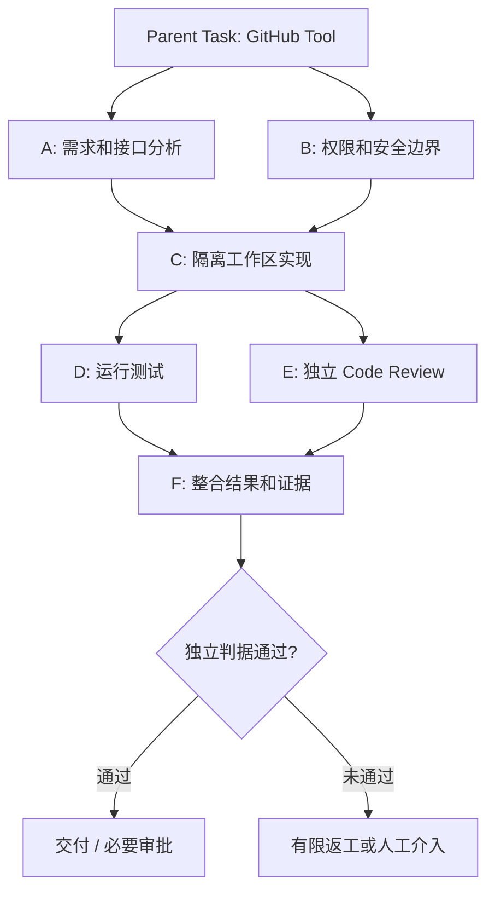

# 12 · Mode Architecture：Work Profiles × Execution Strategies

> **2026-11-21 最小 Plan 实施路径**：通用 [28 · Conversational & Autonomous Planning MVP](28-conversational-planning-mvp.md) 将本篇 §6 的 3–5 节点 WorkflowPlan 草案抽取为 **General/Research/GitHub/Coding 共用的 Parent Task 计划原语**，作为 [#90](https://github.com/yuanbaoerer/personal-agent/issues/90) 与 [#91](https://github.com/yuanbaoerer/personal-agent/issues/91) 的 MVP P0，而**不是本篇完整 Organization Strategy、ModeRegistry 或多 Agent 编队已实现**。计划不代表授权；不得建立第二个 Coordinator/TaskService。

> **2026-11-20 扩展维度**：增加 ExtensionPolicy（见 [25 · Extension Platform](25-extension-platform.md) / [#73](https://github.com/yuanbaoerer/personal-agent/issues/73)），在 WorkProfile × ExecutionStrategy × ModelPolicy 上选择 Plugin/Skill/Tool/Runtime 能力并收紧权限。不是新的执行模式或平行授权系统，最终约束仍由 Core Mandate/ActionService 执行。GitHub 与 Coding Runtime 验证可组合能力；本篇原第三维设计保留。

> **状态：设计方案（2026-11-17），尚未实施。** 本文记录经讨论确认的架构方向，非已上线功能清单。运行事实以 [README](../README.md)、源码和真实验收记录为准。
>
> **核心定位：One Agent Core + Pluggable Work Profiles + Bounded Execution Strategies。**
>
> 关联文档：[产品定位](00-product-plan.md) · [现有架构](02-architecture.md) · [长期路线图](07-long-term-roadmap.md) · [评测](08-evaluation.md) · [跨平台客户端](10-client-platforms.md) · [全球开源](11-global-open-source-community.md)。

## 1. 设计决策与术语

Personal Agent 当前基于 dsh-superagent 风格的 **Task / Assignment / Mandate / Approval / Coordinator** 思路构建，并不是要构建几套各自拥有数据库和状态机的 Agent 软件。“智能组织”借鉴的是任务组织、知识沉淀和反馈改进理念，**不是百度企业组织图的逐项复刻**。

- **WorkProfile（工作领域）**：回答“做什么”。定义技能、候选工具、上下文与验收判据，例如 `general`、`coding`、`research`。
- **ExecutionStrategy（执行组织策略）**：回答“怎么做”。定义 `direct`、`delegated`、`organization`；它们共享权限、预算、持久状态和日志。
- **Mode / Preset（产品上的模式按钮）**：易于理解的预设。可提供「通用」「编程」「智能组织」三个入口，但其内部不是三个互斥的后端实现。
- **Core**：现有唯一 Coordinator/TaskService/Assignment/Mandate/ActionService/Approval/Scheduler/AgentRuntime/Storage/Inbox/Outbox 及 Client API；所有模式共享一个权威任务状态。
- **Organization Workflow**：未来有界、可恢复、具有依赖关系的工作流，不等于任意多个 Agent 的自由互聊团队。

**关键区分：Coding 是 Profile，智能组织是 Strategy。Coding + Organization 合法且应成为示范组合。**

| 用户看见的预设 | WorkProfile | 默认策略 | 行为 |
| --- | --- | --- | --- |
| 通用 / General | general | direct，复杂请求可 delegated | 查询、提醒、轻量事务 |
| 编程 / Coding | coding | delegated | 受控代码阅读、实施、测试与 Review |
| 智能组织 / Organized Work | general/coding/research 按目标指定 | organization | 依赖分解、受控并行、整合、独立验收 |

高级用户可手动组合两轴；普通用户只需选择预设。Router 可以建议模式，但不能私自增加权限或费用上限。

## 2. 模式组合矩阵

| 工作领域 | Direct | Delegated | Organization |
| --- | --- | --- | --- |
| General | 简短回答、只读查询 | 持久个人任务 | 多步骤个人目标 |
| Coding | 代码解释 | 单任务 Worker + 工具 + 代码验证 | 分析/安全 → 实现 → 测试/Review |
| Research | 简短问答 | 一次研究任务 | 多方向取证 → 交叉校验 → 综合报告 |

选择 Organization **不意味着必须实例化多个常驻角色**。实际节点可以由相同 Worker 类型按不同工作说明执行；全实例仍最多同时运行两个 Worker（除非未来有独立经验证的容量变更）。

`direct` 对纯即时回复可不创建长期 Task；一旦需要持久工作、外部写入、审批或预算，仍必须进入既有 Coordinator / Task / Action 通路。Direct 不能绕过治理逻辑。

## 3. 与当前 Core 的可演进关系

| 现有模块 | 必须保留 | 模式扩展 |
| --- | --- | --- |
| Client/Channel Adapter | 身份、来源、去重、投递 | 提交期望 Profile/Strategy |
| Router | 理解意图、建议行动 | 推荐模式，但不授权 |
| Coordinator / Task | 唯一的任务状态与变更入口 | 冻结本次模式/版本与生效预算 |
| Assignment / Worker | 派工、租约、fencing、独立上下文 | 绑定 Profile 和可选 Workflow node |
| Mandate | 用户授权资源和工具的实际边界 | 与 Profile 候选工具取**交集** |
| Action / Approval | 外部写动作校验、批准、执行、核对 | 所有策略复用同一安全通道 |
| Scheduler / Effects | 并发名额、唤醒、超时和恢复 | 组织节点按 DAG 依赖派发 |
| CompletionVerifier | 独立外部证据和人工验收 | Profile/Node 定义不同完成判据 |
| Memory / Knowledge | 有来源、可删除的内容 | 读取项目上下文或经审核 Skill |
| Inbox / Outbox | 幂等输入和可靠投递 | 发布阶段事件而非额外私有消息系统 |

现有应用尚无 ModeRegistry、持久 WorkflowPlan 或 Coding 沙箱。**不得为了模式创建 CodingCoordinator、OrganizationCoordinator 或复制 Task/Approval 数据表。**

候选模块是小型的 ModeCatalog / ProfileResolver / StrategyPolicy / WorkflowRepository。只有当第一条真实 Mode 流程证明需要时再创建。

## 4. 配置与版本契约（示意，并非现成代码）

```ts
type WorkProfileId = "general" | "coding" | "research";
type ExecutionStrategyId = "direct" | "delegated" | "organization";

interface TaskModeRequest {
  profile: WorkProfileId;
  strategy: ExecutionStrategyId;
  requestedMaxWorkers?: number;
  requestedBudget?: {
    maxTokens?: number;
    maxCostUsd?: number;
    timeoutMs?: number;
  };
}

interface ResolvedTaskMode {
  profile: WorkProfileId;
  profileVersion: string;
  strategy: ExecutionStrategyId;
  strategyVersion: string;
  // 服务端有效限制：不得由客户端或 LLM 自行决定。
  effectiveLimits: {
    maxWorkers: number;
    maxTokens?: number;
    maxCostUsd?: number;
    timeoutMs: number;
  };
  resources: string[];
  tools: string[];
}
```

- Task 创建时冻结已解析 Profile/Strategy/版本/有效权限；Assignment 引用对应版本。Profile 定义热更新**不能**改变执行中任务的行为。
- 有效工具、资源应为「用户 Mandate ∩ Profile Capability ∩ 服务端策略」。请求的预算和并发只会被收紧，不会越过全局上限。
- Mode 切换、资源扩大、组织策略改变属于显式任务修订：Task revision 增加，旧 Assignment、旧 Workflow Plan 和待执行 Action 失效；不能在运行中悄悄替换系统指令或扩大工具范围。
- 模式定义只包含候选技能、工具类型、Prompt 版本、Verifier 和配置建议；不保存主人 API Key，也不能包含绕过审批的开关。

## 5. Coding Profile 的安全边界

首个 Coding 版本应优先支持：仓库只读分析 → 有权限的隔离工作区修改 → 本地测试 → 产生变更摘要/PR 建议。

必要约束：
1. **Workspace scope**：绑定仓库、工作树/工作区、基线 commit、允许路径和写入范围。优先隔离 git worktree，避免覆盖用户现有未提交更改。
2. **工具权限分级**：read-only、workspace-write、test-execute、git-commit、git-push/open-PR 分开授权；不能因选 Coding 就获得任意 Shell、整个磁盘或网络访问权。
3. **执行隔离**：若需要执行测试，必须使用实际可用的沙箱或明确限定的可执行命令/目录与 CPU、网络、时间限制；没有真正隔离能力时不能宣称已沙箱化。
4. **独立验证**：程序测试结果、静态检查、文件 diff、仓库来源和 Review 结果必须可核对，Worker 自称通过不算完成。
5. **副作用审计**：外部 Git 写入和其他第三方写操作继续由 ActionService / Approval 限权，保留 unknown/reconcile；明确本地工作区写是否需单独审批与撤销策略。
6. **跨平台**：macOS Apple Silicon/Intel 和 Windows x64 的路径、编码、文件锁、进程退出语义必须分别实测；不把 WSL 当成 Windows 原生方案。

Coding 本身可以使用 Direct/Delegated；只有当多阶段依赖确有收益时才启用 Organization。

## 6. Organization Strategy 的有界工作流

示例请求：“为 personal-agent 设计并实现一个 GitHub Tool，完成测试和代码安全 Review。”



A–F 是工作节点，不是六个常驻 Agent。Planner 只能提出 WorkflowPlan 候选，程序应核验 DAG、预算、权限、节点上限和依赖；不允许模型无限自由增殖。

```ts
interface WorkflowNodeSpec {
  id: string;
  title: string;
  dependsOn: string[];
  profile: WorkProfileId;
  requiredTools: string[];
  requiredResources: string[];
  verifierId: string;
  maxAttempts: number;
  timeoutMs: number;
}

interface WorkflowPlan {
  parentTaskId: string;
  planVersion: number;
  taskRevision: number;
  nodes: WorkflowNodeSpec[];
}
```

必须遵守的状态与运行约束：

- **有界**：初期技术 Spike 只允许 3–5 个节点、依赖无环、无嵌套递归、全实例最多 2 Worker、有限重试/总 token/费用/总超时。
- **父子授权单调**：任何 node 的生效 Mandate 都必须是 Parent Task Mandate 的子集；Plan 不具备新增授权的权力。
- **依赖调度**：节点只在所有必要前置节点独立验收通过后才从 blocked 变 ready；节点失败要合理传播到 Parent 的 failed/needs_review，不得误报 succeeded。
- **版本化**：保存 planVersion/nodeId/assignmentId/inputSeq/fencingToken/taskRevision，旧计划的结果不能覆盖新的用户补充或修订。
- **取消与恢复**：Parent 取消时禁止后续节点派发、让旧 Action 失权；已经发出的外部副作用进入核对状态。进程重启能从持久化节点状态恢复，不能仅依赖 Pi 文本上下文中的计划。
- **汇总验收**：最终交付使用来源、测试、Review 等可核对证据；由 Coordinator/Verifier 判断满足父任务完成条件，不能仅依据模型报告。
- **跨模式一致性**：相同 Task 在飞书、CLI、TUI、Desktop 的状态/审批/预算是同一份数据库事实。

Organization 更耗时、耗 token 也更复杂，不能因为“任务看起来很复杂”就默认使用。

## 7. Skill、Knowledge 和持续改进（长期候选）

“智能组织”真正值得借鉴的不是固定岗位，而是经验可复用与执行可改进。应区分：

| 数据资产 | 内容 | 约束 |
| --- | --- | --- |
| Profile Memory | 主人明确保存的事实和偏好 | 查看/导出/删除 |
| Project Context | 仓库架构、决策、文档和来源 | 项目隔离、来源/TTL |
| Skill | 经验证的做事方法、工具边界、验收判据 | version、禁用/回滚 |
| WorkflowTemplate | 经验证的节点依赖模式 | 版本与适用 Profile |
| Execution Experience | 成功/失败、成本、人工评语 | 审计/脱敏/有期限 |

推荐长期改进循环：

```text
任务执行 → 程序/外部结果验证 → 人工评价
         → 失败归因 → Skill/Template 改进候选
         → 基准样例回归 → 人工批准新版 → 新任务采用
```

**不允许** Agent 将未经验证的“经验”自动提升为可信 Skill，或未经审批自动改写代码、系统 Prompt、权限规则、生产配置。Memory 不是授权，Skill 也不是另一个永久人格的 Agent。

Versioned SkillRegistry、Human Feedback Pipeline 和受控 Improvement Loop 为**后续设计候选**；不作为 v0.2、v0.3 或 Public Alpha 的发布前置要求。

## 8. 多终端 UX 和统一 API

CLI / TUI / Desktop / IM 可提供「通用、编程、智能组织」入口；高级设置允许 Profile + Strategy 组合。**所有客户端只是同一 Core 的 UI**。

候选接口（不是已实现端点）：

| API/事件 | 用途 |
| --- | --- |
| `GET /modes` | 返回可用预设与兼容模式，标注 experimental/unavailable |
| `POST /tasks` | 提交 TaskModeRequest，由 Core 生成 ResolvedTaskMode |
| `GET /tasks/:id` | 查询有效 Profile/Strategy/版本、授权、预算 |
| `POST /tasks/:id/revise` | 改模式或目标，需要 revision 与新授权校验 |
| `GET /tasks/:id/workflow` | 组织计划节点、依赖、进度、证据 |
| `GET /events` | 任务/节点/审批事件流，支持 cursor 断点恢复 |

示例 CLI（仅规划）：

```bash
pa task create --profile coding --strategy delegated "review repo"
pa task create --profile coding --strategy organization "implement feature"
```

实际协议应服从 [PA-17](https://github.com/yuanbaoerer/personal-agent/issues/19) 的 Client API 设计。未实现的 Organization 不应在可用模式列表中假装“已支持”。

## 9. 实施阶段与不做事项

| 阶段 | 做什么 | 前置条件 | 不做 |
| --- | --- | --- | --- |
| **v0.2 Reliable Core** | 保持现有 SuperAgent 风格基座；真实消息→Router→Worker→结果、Task 一致性、授权、恢复与安全 | PA-01～06、PA-25 | 不实现新模式框架/DAG |
| **v0.3 最小可用模式候选** | General/Coding WorkProfile 的最小声明、版本快照及 Direct/Delegated；先用测试入口验证，不要求所有正式 UI 就绪 | PA-01/03/07/09/25；PA-13/17/18 中必要的最小契约可提前抽取，完整工作项不构成阻断 | 不允许任意 Shell/全盘文件写 |
| **v0.4 之后 Strategy Spike** | Organization WorkflowPlan/DAG、节点验收与恢复、限制成本；与 Delegated 比较 | PA-02/04/05/06/09/11 | **不把 Organization 作为 v0.4 开源阻断项** |
| **后续稳定化** | 版本化 Skill/Workflow 模板、反馈与可回滚的受控进化 | 真实使用与基准证据 | 不自动自我改写/无限 Agent |

独立候选工作包（**不是现有 GitHub Issue 编号**）：

| ID | 交付 | 推荐优先级 |
| --- | --- | --- |
| MODE-01 | WorkProfile / ExecutionStrategy 声明、服务端解析、版本冻结（先最小实现，不等待完整 PA-13） | v0.3 P1 |
| MODE-02 | Coding Profile：隔离工作区、受控工具、真实验证器 | v0.3 P1/P2 |
| MODE-03 | Organization Plan：DAG、任务依赖、取消/恢复、预算 | v0.4+ P2 |
| MODE-04 | Delegated vs Organization 受控 Benchmark 与质量门槛 | v0.4+ P2 |
| MODE-05 | SkillRegistry、Human Feedback、Improvement Loop 试验 | 更后期 |

这些工作包先作为设计文档维护。进入实施排期时检查已有 PA-01～PA-29，再开 Issue，避免抢占此前尚未创建的 PA-30/31/32 建议编号。

## 10. 独立评测与准入判据

Mode 专项测试不混入既有 40 场景，也不替换 K01–K17 / SEC01–SEC08：

| ID | 主要断言 |
| --- | --- |
| MODE01 | 不兼容或未实现的 Profile/Strategy 组合显式拒绝 |
| MODE02 | Mode 不能扩大 Mandate/Action/Tool 权限 |
| MODE03 | Profile 和 Strategy 热更新不影响进行中的任务版本 |
| MODE04 | 修订/取消后旧 Assignment、Plan、Action 失效 |
| MODE05 | DAG 不允许环、未知依赖或无界节点 |
| MODE06 | 全实例 Worker 上限、预算、超时和人工响应优先 |
| MODE07 | Workflow 故障恢复和幂等/unknown 核对 |
| MODE08 | Coding Workspace/路径/Shell/Git 的权限隔离 |
| MODE09 | 独立验证器拒绝自述式成功 |
| MODE10 | 多客户端模式/任务/审批权威状态一致 |

组织策略是否值得默认使用必须用受控 Benchmark 决定：至少 10 个有明确外部完成条件的可分解 Coding/Research 任务；同模型、可比工具与预算规则；Delegated 与 Organization 分别至少独立运行 3 次。报告逐次成功率、程序验证质量、人工干预、token/费用、时延、失败与恢复。只有获得可复现的净收益且满足零未授权执行/恢复约束，才考虑推广；否则继续默认 Delegated。

## 11. 设计边界和决策记录

**已确认的设计方向**：双轴 Profile/Strategy；界面使用 Mode preset；现有 Task/Assignment/Mandate/Approval Core 不分叉；Coding/Organization 可以组合。

**尚未确认的实施方式**：WorkflowPlan 的最终表结构、ProfileRegistry 接口、隔离 Sandbox 的具体技术、SkillRegistry 和训练/记忆策略。需要以代码 spike、权限测试和真实性能指标为依据。

**明确排除**：v0.2 重构成多 Agent 平台、多 Coordinator/多 Task DB、无限嵌套派工、基于 LLM 自述的审批/验收、自动获得 Shell 权限、未审核自我修改，以及将 Organization 设为全球开源的发布前置门槛。

这份规划的目的，是为长期演进保留可扩展的产品抽象，同时不稀释当前 v0.2 最重要的可靠性、安全和实际可用性任务。

## 12. 第三个正交维度：ModelPolicy（2026-11-17）

现有 Mode Architecture 由两个维度扩展为 **WorkProfile × ExecutionStrategy × ModelPolicy**：

- WorkProfile：`general/coding/research`，决定做什么及所需工具能力、知识与验证器。
- ExecutionStrategy：`direct/delegated/organization`，决定如何组织任务和 Worker/Workflow Node。
- ModelPolicy：决定 Router/Worker/不同 Node **分别使用哪个经验证的模型或路由组**、预算多少、是否允许有界降级；它不赋予新的 Mandate 权限。

例如 `coding + organization` 可以为 Router、Planner、Implement、Review 选择不同模型，仍由同一个 Parent Task 统一控制成本和 Worker 名额（当前上限 2）。ModelPolicy 的静态角色映射先于任何基于模型判断的动态路由。每个 Assignment/Session 的实际 `ResolvedModelBinding` 应保存 modelRef、Provider/Gateway 来源、策略版本及使用预算；Profile/策略热更新不影响在途 Session。

**Magpie 是可选 Gateway，不是第三个独立 Agent 核心，也不是开源发布前置依赖**。具体路由/故障转移/路由组/节点模型分配和独立 MRT 测试见 [13 · Model Routing & Gateway](13-model-routing-gateway.md)；新能力在真实 Pi Session 验证之前均为规划。
