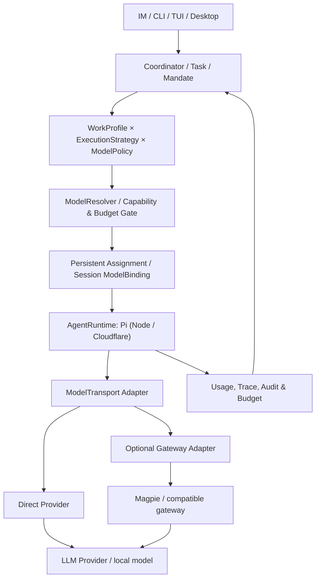

# 13 · Model Routing & Gateway Architecture

> **状态：已选定设计方向，待实现（2026-11-17）。** 本文定义长期模型策略与 Magpie 可选适配能力，并不代表当前 Pi Runtime 已支持 per-Worker/per-Assignment 选模型、多个 Provider 或自动故障转移。
>
> 产品总架构：**One Agent Core + WorkProfile × ExecutionStrategy × ModelPolicy**。模型路由是 Core 的能力策略，不是另一套 Agent 调度系统。
>
> 关联：[02 · Architecture](02-architecture.md) · [07 · Roadmap](07-long-term-roadmap.md) · [08 · Evaluation](08-evaluation.md) · [09 · Open-source](09-open-source-plan.md) · [12 · Modes](12-mode-architecture.md) · [PA-13 Provider Adapter](https://github.com/yuanbaoerer/personal-agent/issues/14) · [PA-24 全球可用性](https://github.com/yuanbaoerer/personal-agent/issues/27)。

## 1. 为什么要引入 ModelPolicy

Personal Agent 不是只有一个回答型模型。Router、不同 WorkProfile 的 Worker，以及未来 Organization Workflow 的各个 Node，需要的能力不同：

| 角色 / 工作单元 | 模型目标 | 默认路由 |
| --- | --- | --- |
| Router | 意图分类、任务路由、低延迟、低成本 | 优先较轻模型，但必须能稳定输出受控结构 |
| General Worker | 常规问答、总结、已授权轻工具 | 通用模型 |
| Coding Worker | 代码理解、工具使用、长任务、多文件修改 | Coding 能力已验证的模型 |
| Research Worker | 检索/证据整理、引用和上下文处理 | 能力/上下文适配的模型 |
| Planner（未来的 Workflow 阶段） | 任务拆分、依赖分析 | 较强规划模型，仅 Organization 启用 |
| Reviewer（未来的 Workflow 阶段） | 独立验证或代码 Review | 可选独立模型，**不替代程序验证器** |
| Summary Phase | 将已验证结果格式化输出 | 低成本模型或确定性程序 |

这里的角色是**会话/Assignment/Workflow Node 类型**，不等于同时创建七个常驻 Agent。全实例最多两个活动 Worker 的既有约束不变。角色模型配置必须可替换，不能依赖编写七份不同的 Coordinator。

现阶段现状（以当前 main 对应代码为准）：
- `apps/agent/src/runtime/types.ts` 的 `RuntimeSessionSpec` 仅有 `role` 和 `brief`，尚无 model binding。
- `apps/agent/src/runtime/node-pi.ts` 的 `NodePiRuntimeOptions.model` 在 Runtime 实例层配置，`open()` 创建的会话共用该默认模型。
- `apps/agent/src/runtime/pi.ts` 的 `PiRuntime.open()` 目前没有消费 `spec` 中的模型选项。
- `infra/src/worker.ts` 的 Cloudflare 环境仍有固定默认模型与固定的 opencode-go Provider 配置。
- `PA-13` 已规划最小多 Provider / ModelProviderConfig；`PA-24` 已规划 BYOK 和跨地区使用验证；**都不等于 per-Worker 路由已经实现**。

因此第一步是**会话级模型绑定 + 可验证的 Provider 能力目录**，而不是先做网关或 LLM 自动选模型。

## 2. 层次划分与数据流



职责边界：

1. **ModelCatalog**：记录模型/路由组的逻辑标识、来源、协议、能力、上下文限制、价格元数据（若可信）、是否可用及验证时间。
2. **ModelPolicy**：根据用户显式配置、WorkProfile、ExecutionStrategy、角色/节点、最低能力、数据出站规则和预算，给出*请求的*模型选择。
3. **ModelResolver**：将请求转成**可以真正启动**的 `ResolvedModelBinding`；做能力/可用性/配额/权限检查，并冻结绑定及策略版本。
4. **AgentRuntime**：负责 durable Pi Session 生命周期、提交、等待、中断及 requestId 幂等，不负责决定谁有权访问哪个仓库或执行哪个 Action。
5. **ModelTransport**：直接 Provider 或可选 Gateway（Magpie）协议适配，处理 HTTP、流式、工具调用和模型目录协议差异，不做任务编排。
6. **Telemetry / Budget**：按 Task、Assignment、Session、请求和真实使用记录成本、延迟、失败与实际 Provider/Model；价格未知时不编造金额。

**禁止的结构**：另建一套 MagpieCoordinator / ProviderWorker / Gateway Task DB，或者将工具授权、任务恢复和审批策略下放到网关中。

## 3. ModelPolicy 解析优先级与安全规则

### 3.1 解析优先级

建议先采用确定性匹配规则：

1. 服务端硬性限制：允许的 Provider/地域出站、已授权 Gateway/身份、最大预算、禁用模型、能力白名单；
2. Task / 用户显式模型选择（在有效授权内）；
3. Organization Node 或 Assignment 对该角色的模型要求（受 Task 根预算约束）；
4. WorkProfile 默认建议；
5. Router/Worker/Verifier 角色默认建议；
6. 实例级 fallback/default。

其中 **安全限制不是第一级可被覆盖的首选项，而是对所有候选都生效的约束**。模型给出的字符串不是用户的安全授权；候选不可用时不能静默切换到能力更弱或隐私条件不同的模型。

系统默认策略：**静态角色映射 → 能力验证 → 固定会话模型**。不使用额外 LLM 为每次请求再次判断该用哪家 Provider；动态意图路由必须经独立 Benchmark 证明收益。

### 3.2 领域接口示意（非现有代码）

```ts
type ModelBackend = "direct" | "gateway";

interface ModelRef {
  backend: ModelBackend;
  catalogId: string; // e.g. "router-fast", "coding-strong"
}

interface ModelRequirements {
  toolCalling?: boolean;
  structuredOutput?: boolean;
  minContextTokens?: number;
  requiredModalities?: ("text" | "image")[];
  dataPolicyId?: string;
}

interface ModelSelectionRequest {
  taskId: string;
  taskRevision: number;
  assignmentId?: string;
  workflowNodeId?: string;
  profileId: "general" | "coding" | "research";
  strategyId: "direct" | "delegated" | "organization";
  role: "router" | "worker" | "planner" | "reviewer" | "summary";
  requirements: ModelRequirements;
  requestedModel?: ModelRef;
}

interface ResolvedModelBinding {
  policyVersion: string;
  catalogVersion: string;
  backend: ModelBackend;
  modelRef: string; // public logical ID or gateway route ID
  providerRef: string; // direct provider or gateway adapter identifier
  modelId: string; // selected model identifier at admission
  maxTurns: number;
  timeoutMs: number;
  // Snapshot: does not grant tool or resource permissions.
  capabilitySnapshot: ModelRequirements;
  budgetRef: string;
}

interface RuntimeSessionSpec {
  role: "router" | "worker";
  brief: string;
  modelBinding: ResolvedModelBinding;
}
```

**以上只是架构契约草案**；`PiHarness` 和 `@earendil-works/pi-durable` 的实际 per-conversation model API、Node 与 Cloudflare 环境支持必须各自做最小运行 Spike，验证不能仅凭 TypeScript 能编译。

### 3.3 版本和授权

- 在 **Assignment/Session 创建时**冻结实际 ModelBinding，持久记录 policyVersion、modelRef、backend、能力快照、预算与请求来源；Router 的长期 Session 同样冻结其模型绑定并有明确轮换策略。
- 任务模式切换/用户明确指定模型、或策略调整不得悄悄重写进行中 Session 的配置；需要使用经确认的新 revision、Assignment/Session，并保留旧绑定与原因。
- 未来 Organization 的 Workflow Node 可覆盖 *候选* ModelRef，但不得超出父任务的授权出站范围、费用和总 token/时限。
- 所有 Worker 工具权限仍由 Mandate/ActionService 决定；使用昂贵或强大的模型不会提高业务权限。

## 4. Direct Provider 与 Gateway Adapter 是平等选项

### 4.1 Direct Provider（必须保留）

用户可以仅配置一个受支持的 Provider 和模型，启动 Personal Agent，无需安装 Magpie、额外反向代理或额外账户。Provider Adapter 负责身份/调用、能力检查、错误归类、重试契约。至少要真实验证 **两个不同 Provider 配置**，才可宣布“多 Provider 支持”；未经验证不宣称所有 OpenAI 兼容模型可用。

### 4.2 Magpie Gateway（可选）

参考开源 `yetone/magpie` 的官方文档（以接入时的真实版本为准）：

- https://github.com/yetone/magpie
- https://github.com/yetone/magpie/blob/main/docs/integrating.md
- https://github.com/yetone/magpie/blob/main/docs/reference.md

Magpie 可将不同 Provider、账户/密钥及 routing group 作为统一模型目录对外暴露。Personal Agent **只需要一个可配置的 Gateway Adapter**；Gateway 负责协议转发/供应商路由和其内部帐号能力，Personal Agent 负责任务-模型匹配、权限、Workflow 状态和最终成本归属。

第一版接入方向：
- 配置 `baseUrl`、`credentialRef`、`protocol`、允许的 `modelId` / route group；不把个人密钥写入持久 Task、日志或示例。
- 只读调用模型目录（如适用的 `GET /v1/models`），将动态发现的候选与**本地已验证能力目录**求交集；目录存在不等于 Pi 的工具调用协议完全兼容。
- 路由组可以作为 `modelRef`，但某些路由策略会在相邻请求间切换实际 Provider/Model。对于**要求稳定模型的长期 Pi Session**，必须使用验证后的粘性/固定路径，或者禁用跨模型 route group；否则在每次请求报告实际 provider/model、变更及会话语义，禁止隐形切换。
- 用户关闭或未安装 Magpie 时，Direct Provider 仍可独立工作。

**部署区别：** Node 本地连接可考虑 loopback。Cloudflare Durable Object 的 `127.0.0.1` 不是用户 Mac/Windows 的回环地址；远程网关必须经用户授权的 TLS 可达端点、认证和最小暴露策略，不建议默认公开本地网关端口。

### 4.3 兼容边界及安全

- Pi 的实际协议可能包括流式输出、工具调用、结构化输出、reasoning 和多轮状态。**仅 HTTP 端点返回 200 或 /v1/models 有条目，不构成兼容证明**。
- Gateway 对请求/响应可能具有明文访问权；Data Flow 文档、Provider 数据所在地/保留、密钥传输与可选 telemetry 必须披露。
- Gateway key 若可限定模型/账户/预算，则使用最小授权；不能因为默认 Gateway 位于 localhost 就免鉴权或允许任意网络设备访问。
- 要对 SSRF 和内网访问明确约束：不让不可信模型输出任意 `baseUrl` 或任意 HTTP 头/credentialRef；网关端点由可信 owner 配置和验证。
- 供应商订阅/路由组可能附加各自服务条款与额度限制；本项目不能保证所有 Provider 在所有地区可用。

## 5. Fallback 与会话连续性的硬约束

模型请求失败有多类情况，不能混为“换一家重试”：

| 情况 | 初期策略 |
| --- | --- |
| 创建 Session 前模型不存在 / API Key 无效 / 不支持 required tools | admission 拒绝或在**授权的兼容候选集合**内选备用模型，记录决策 |
| 尚未开始实际模型推理、且可确定没有任何工具调用 / 副作用 | 可根据幂等/重试契约尝试有界 fallback，记录同一 request causality |
| 模型输出已开始流式返回、部分工具调用已执行或远端是否接受请求未知 | **不得透明切换**。记录 unknown/pending/failed，按实际状态核对；需要时用新的 Assignment/Session 重新规划 |
| 已产生待审批 Action 或跨 Task revision | 任何切换都不保留旧授权；必须重新校验现有 Task/Mandate 与 Action |
| Gateway 内部自动 fallback / 隐式路由 | 不能完全识别实际 Provider 时显式标记 `unverified_route`；不能假装“固定模型已验证” |

**切换模型不得重复执行外部动作。** Pi 的提交 `operationId` / requestId 幂等（K03）及 Action 的消费、未知结果核对（K08–K14）仍是最终业务边界。模型路由失败不可令 Task 错误标记 succeeded 或悄然重放先前工具写入。

对必须确保模型固定的会话，跨模型切换应先安全停止旧 Assignment、根据任务持久上下文重新建 Session、明确新的版本引用；是否允许“对已存在 Pi Session 热换模型”由真实 SDK Spike 和合同测试决定，而不是预设可以。

## 6. 观测、预算和成本归属

每次请求至少关联：`taskId`、`assignmentId`、可选 `workflowNodeId`、`sessionId`、`operationId`、`policyVersion`、`requestedModel`、`routedModel`、`gatewayRoute`、`provider`、token usage、first-token/total latency、retry/fallback reason、错误分类、预算累计。

- 根据**来源**保留用量字段：runtime/provider 反馈、gateway 反馈、估算值相互区分，避免双重计费与伪精度。
- 未知真实 Provider/Model 时如实显示 unknown；路由组模型名不等于实际出资/计费方的模型名。
- 为 instance/day、Task、Assignment、Workflow Node 做分层预算；预算耗尽必须阻止**新的**模型请求，并让在途请求标明消耗不确定性。
- 成本元数据过期或无法可信报价时展示 token/请求量与“金额未知”；严格货币预算模式可 fail closed，而不是默默放行无限费用。
- 前端可显示不同 Worker 使用的模型及用量，但不展示 Gateway 凭据；隐私规则见 [11 · 全球开源](11-global-open-source-community.md)。

这部分与 [PA-06 可观测性/预算](https://github.com/yuanbaoerer/personal-agent/issues/7) 一体建设，不能另造第二套成本审计表而缺少端到端 trace。

## 7. 与 Mode Architecture 的集成

```text
WorkProfile      = 做什么（General / Coding / Research）
ExecutionStrategy = 如何组织（Direct / Delegated / Organization）
ModelPolicy      = 用哪个模型、满足什么能力、花费多少、怎样退回
```

例子：`coding + organization`：
- Router 用低延迟且结构化输出稳定的模型；
- Planning Node 可用经测试的复杂推理模型；
- Implement Node 使用 coding 强模型；
- Test/Review Node 可以使用独立模型，但验收仍以测试/差异验证为主；
- Summary Node 使用小模型或确定性格式化；
- 所有请求的并发名额/预算总量由**同一 Parent Task**和全实例 Scheduler 管理。

不引入固定“Planner Agent/Coding Agent/Reviewer Agent”长驻服务。每个 WorkflowNode 的 model selection 只是被授权的能力配置，不能越过父任务范围。

## 8. 测试契约：MRT01–MRT10（独立统计）

| ID | 场景 | 必须证明 |
| --- | --- | --- |
| MRT01 | 不同 Role/Assignment 指定不同模型 | Router 与两个 Worker 的真实会话配置分离、无全局覆盖 |
| MRT02 | Task/Session 模型绑定版本 | 运行中策略热更新不改变已建 Session/Assignment |
| MRT03 | 能力缺失 | 缺 tool calling/JSON/context 需求时显式拒绝或在授权集内退回 |
| MRT04 | Direct / Gateway | 相同只读 G1 在两种可达配置下可运行，保留不同证据 |
| MRT05 | 网关 routing group / provider 身份 | 区分请求逻辑组与实际 provider/model；未知不猜测 |
| MRT06 | 限额、故障转移与重放 | 429/超时/断流后不会重复工具写入或绕过幂等 |
| MRT07 | 预算硬限制 | token/金额未知/超限行为明确，Router/Worker 总费用不漏计 |
| MRT08 | 安全与地域 | 未授权 Gateway/URL、泄露 token、跨区域禁止出站均拒绝 |
| MRT09 | Node / Cloudflare 兼容 | 每个已声明宿主真实 Pi Session 路由与恢复证据独立 |
| MRT10 | 评测成本收益 | 角色模型分配 vs 单一固定模型的成功/质量/人工干预/成本/时延 |

- **MRT 测试不是原 40 场景的一部分**，也不替代 MODE01–MODE10、K01–K17 和 SEC01–SEC08。
- 从 2 个真实 Provider 配置 + 1 个可选网关真实实例开始；做独立 Session 连续多轮、带工具调用/结构化输出、超时与重启验证。
- 对同一代表性 Coding/Research 任务设置单模型基线与角色分配策略，固定数据、预算和模型版本，记录实际运行次数及失败。没有可复现质量/成本收益，不默认启用动态模型路由。
- 对 gateway 的官方兼容宣传与本项目实际支持的 Pi 协议逐项核对，不以 Magpie 文档功能列表直接宣称本项目已经实现。

## 9. 分阶段规划与现有 Issue 的边界

| 阶段 | 范围 | 对应 |
| --- | --- | --- |
| **v0.2（现在）** | 单 Provider / 默认模型可用，继续优先真实链路、恢复、权限、费用追踪；不做多网关 | PA-01～PA-06 |
| **v0.3（候选）** | 至少两个 Provider 配置、Provider/ModelCatalog、Session 级固定模型，支持 Router/Worker 角色映射，最低能力与安全检查 | PA-13 的最小 Provider 抽象 + MODEL-01 |
| **v0.3–v0.4（可选）** | Magpie Gateway Adapter、模型目录、路由组、用量/故障转移 Spike；不影响 Direct Provider | MODEL-02、PA-24、PA-06 |
| **Organization 后期** | Workflow Node 按 Profile/Role/需求/预算选模型，允许经过验证的有限 fallback、对照评测 | MODEL-03、MODE-03/04 |
| **稳定版本候选** | 跨平台配置管理、Data Flow、策略迁移/版本与按角色报表 | PA-14/17/22/26 |

**现有职责不重复实现：**
- [PA-13](https://github.com/yuanbaoerer/personal-agent/issues/14)：最小多 Provider / AgentRuntime Adapter / Composition Root。
- [PA-24](https://github.com/yuanbaoerer/personal-agent/issues/27)：BYOK、全球 Provider/Channel 可用性与无飞书 CLI 使用。
- [PA-06](https://github.com/yuanbaoerer/personal-agent/issues/7)：任务 trace、硬预算和审计视图。
- [PA-17](https://github.com/yuanbaoerer/personal-agent/issues/19)：统一 Client API；不新增独立模型控制后端。
- MODEL-01：只做真实 Session/Assignment 级绑定与角色配置（补足 PA-13 的 Provider 配置层）。
- MODEL-02：只做 Magpie/兼容 Gateway Adapter 与路由组、流式/工具兼容性 Spike。
- MODEL-03：只做 Organization Workflow Node 级策略和实证优化。

后续若建立 GitHub Issues，需先检查是否已经存在该工作项并添加具体依赖；规划项的存在不代表可用性已经实现。**Magpie 不是安装前置条件，也不应成为 Public Alpha 或 v0.4 Open-source Ready 的新增发布阻断项。**

## 10. ADR 和修改约束

采纳：
- WorkProfile × ExecutionStrategy × ModelPolicy；
- **Task/Assignment 层解析策略，Session 创建时绑定模型**，Node/Cloudflare 都应验证；
- Direct Provider 与 Gateway Adapter 平等，Magpie 仅是首个可选集成；
- 真实请求的 trace、费用、失败及路由路径可审计；
- 不允许模型路由降低 Mandate、安全与隐私约束。

尚未确认：
- Pi SDK 的最终多模型注入/会话接口，以及 Gateway 在所有协议下的等价性；
- Gateway 的组路由是否提供长期会话“固定底层模型”的保证；
- 是否值得由模型动态选模型；需要基准数据决定。

明确不做：
- 在 v0.2 开发独立 Magpie 替代品、通用代理服务器、订阅账户聚合或完整账单管理；
- 在运行中悄悄热换模型、未经核对重放带外部副作用的请求；
- 为新 Provider 建第二份 Coordinator/Task DB 或把模型选择提升为系统权限。
