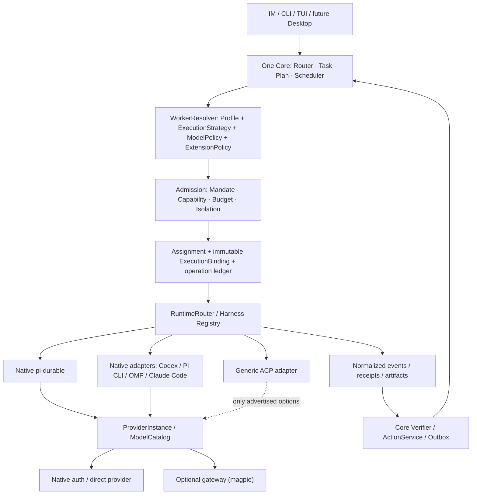

# 30 · Multi-Harness Worker Runtime & Model Gateway Integration

> 2026-11-24 · architecture decision / implementation proposal, not implemented. Baseline: main `000dc30a687862f864e84081ee431fc6fe5b05c8` (#132). 本文是 #63 / MODEL-01–03 的细化契约，不另起 Core、不宣称第三方兼容。与 [02](02-architecture.md)、[12](12-mode-architecture.md)、[13](13-model-routing-gateway.md)、[24](24-github-project-management.md)、[25](25-extension-platform.md) 配套。现有 #41/#92、#65 L2、#7/#28 真实验收及安全门槛保持。

## 1. 产品决策

**One Agent Core + WorkProfile × ExecutionStrategy × ModelPolicy + ExtensionPolicy + Worker execution binding.** Worker Profile 是可复用的角色/执行配置，不是新的模式轴、常驻进程、Task DB 或授权主体。Harness 是执行引擎；Provider/Gateway 是推理服务来源；Model 是模型或路由标识。用户可复用同一 Harness 的不同实例，并为每个 Worker 绑定不同模型、技能、权限上限和运行环境。Core 继续是 Task/Assignment/Plan/Mandate/Action/Approval/Verifier/Scheduler/Memory/Inbox/Outbox/Audit 的唯一权威。Router/Coordinator 初期保留内置 Pi Runtime；不将规划、授权和验收责任交给外部 Coding Agent。

- 内置 Pi 不依赖任何外部 CLI 或网关；Codex、Pi CLI、OMP、Claude Code 是目标可选 Harness（逐个验证才标 supported）。内置 pi-durable 和外部 Pi CLI 是不同 driver，不共享 session ID 假设。
- 允许原生认证/订阅、直接 Provider、外部 Gateway（magpie 优先；其他经验证兼容端点可选）；不复制 magpie 的代理/供应商账号路由业务，不要求用户安装它。
- 用户决定配置及允许的候选池，Core 做确定性解析，后续才做动态调度；LLM 提议不是授权。Coding / Organization 可组合，共享同一核心。
- Driver/registry/生命周期和权限边界属于 Core；具体 driver/gateway 是受信扩展；第三方下载/执行属于 EXT V2/V3，不提前开放。

## 2. 当前实现证据与差距

以下均以基线 SHA 为准，可在 GitHub 切换到该 SHA 核对。

| 已有实现（路径相对于 apps/agent/src） | 差距 / 迁移 |
| --- | --- |
| runtime/types.ts: RUNTIME_CONTRACT_VERSION=1，open(spec)/submit(sessionId,text,operationId)/wait/interrupt，RuntimeSessionSpec 仅 role/brief | 保留契约兼容，新增版本化执行绑定、能力探测、恢复/取消语义；不要先重写全部调用点 |
| runtime/node-pi.ts: NodePiRuntimeOptions.model，open 使用实例级模型；runtime/pi.ts 为 DO 路径 | 首先验证 SDK 会话级模型绑定，再引入按实例构造的 runtime；旧配置继续可用 |
| app.ts: AppDeps.runtime 单例，RouterModel 独立注入；coordinator/tasks.ts: 单一 #runtime open/submit/wait/interrupt | composition root 装配 RuntimeRouter；Router 仍走既有路径；Worker 通过持久 Assignment/Session binding 查找实例 |
| domain/types.ts AssignmentRecord / storage/tasks.ts: taskRevision、sessionId、leaseUntil、fencingToken、dispatchedInputSeq/consumedInputSeq、report | 增量迁移绑定快照、session ownership、外部 job ref 与操作回执；复用既有旧报告屏障 |
| config.ts: SUPPORTED_MODEL_PROVIDERS 仅 opencode-go | 兼容现有 MODEL_PROVIDER/OPENCODE_MODEL/OPENCODE_API_KEY；从静态单配置演进至 ProviderInstance / ModelCatalog |
| observability/magpie.ts: MagpieBudget 只读额度，OpenCode 窗口匹配，不可达时 direct 路径可降级 | 不能称已接入 magpie 推理；新增实际 transport/外部 Harness 配置绑定，网关不可达时只影响绑定到它的任务 |
| plugins/types.ts BuiltinPlugin.createTools；manifest/catalog/fence/skills；Task extension policy | 当前 tool-oriented V1，不直接复用 createTools 假装支持 runtime；按 capability kind 增量扩展并复用 generation/credential/audit |
| coordinator/plans.ts / plan-executor.ts，GitHub typed actions、completion verifier，delivery/effects/outbox | 复用既有持久计划、效应、审批、证据核验。本文不引入通用 DAG 引擎、不假设 Organization 已实施 |
| client-api.ts / client/sdk.ts / cli.ts / tui.ts | 同一 API/鉴权/状态；Desktop 后续共享，不能客户端各自调进程 |
| infra/src/worker.ts | DO 无本地 CLI/宿主文件系统；先 Node 本地执行，DO 只保留已验证内置路径；未来远程 executor 是独立门禁 |

已存在的 [#63](https://github.com/yuanbaoerer/personal-agent/issues/63) 是 Coding Adapter，[#35](https://github.com/yuanbaoerer/personal-agent/issues/35)–[#37](https://github.com/yuanbaoerer/personal-agent/issues/37) 是 ModelPolicy / Gateway 工作包，[#14](https://github.com/yuanbaoerer/personal-agent/issues/14) 是稳定扩展边界。不是新开一套重复项目。

## 3. Target architecture



Model binding is logical: external Harness owns its actual inference transport; PA must use documented per-instance/session settings and observe actual usage where possible, not intercept all inference or promise arbitrary Harness × model combinations. ACP is an Agent control protocol; MCP is a tool integration protocol. They are complementary, not interchangeable.

## 4. Domain contract (illustrative, not shipped)

| Entity | Responsibilities |
| --- | --- |
| WorkerProfile (owner-scoped id/revision) | role, purpose, WorkProfile compatibility, HarnessInstanceRef, requestedModelRef, skill refs, capability requirements, policy ceiling, resource limits; default disabled for unvalidated configs |
| HarnessDriver | versioned protocol adapter, discovery, supported OS/transport, contract tests; driver ID is not model provider ID |
| HarnessInstance (id/revision) | driver version/digest, verified executable or SDK, authRef, endpoint/configRef, execution environment, capability snapshot, generation, connection status |
| ProviderInstance (id/revision) | native-auth/direct/gateway, protocol, trusted endpoint, credentialRef, catalog, egress rules; native auth model may be non-overridable |
| ModelRef / ModelCatalog | logical ID, actual model/route if known, modality/context/tool/protocol/cost capability, provenance and verifiedAt |
| ExecutionBinding | immutable snapshot per Assignment, referenced by Session; worker/profile revision, harness instance/driver version, provider/model/route, policy/catalog/generation, project/workspace, task revision, budget, isolation profile |
| RuntimeOperation / RuntimeSessionRef | durable host operationId, adapter-specific session/job ID (opaque), phase, external status, last event cursor, receipt/uncertainty; never store tokens |
| RuntimeCapabilities | resume, idempotentSubmit, interrupt, eventReplay, approval mediation, modelOverride, usage, sandbox, artifact support: supported/unsupported/unknown plus evidence |

```ts
// Target shape only; extend rather than replace existing AgentRuntime v1 blindly.
interface ExecutionBinding {
  workerProfileId: string;
  workerProfileRevision: number;
  harnessInstanceId: string;
  harnessRevision: number;
  driverVersion: string;
  providerInstanceId?: string;
  modelRef?: string;
  resolvedModelId?: string;
  policyVersion: string;
  catalogGeneration: number;
  taskRevision: number;
  budgetRef: string;
  isolationRef: string;
}
interface HarnessDriver {
  discover(instance: HarnessInstanceRef): Promise<CapabilitySnapshot>;
  open(spec: BoundSessionSpec): Promise<OpenedSession>;
  submit(sessionId: string, text: string, operationId: string): Promise<RuntimeSubmission>;
  wait(sessionId: string, operationId: string, timeoutMs?: number): Promise<RuntimeAnswer>;
  interrupt(sessionId: string): Promise<void>;
  reconcile?(ref: RuntimeOperationRef): Promise<ReconciliationResult>;
}
// Optional features have capability gates. Unsupported is not simulated success.
```

Use the existing four methods via a versioned RuntimeRouter façade. Native Pi v1 wrapper preserves semantics. Adapter events may additionally expose text delta, tool proposal, approval request, usage, artifact, terminal and unknown; event IDs/cursors allow bounded replay/dedup. External transcript is not trusted evidence. WorkerReport is a normalized proposal to Core (not an authorization or direct Task state write). No generic forced resume or retry if adapter cannot prove it.

### 4.1 Illustrative owner configuration (not current YAML/API)

```yaml
schemaVersion: 1
providers:
  - id: native-codex
    kind: native-auth
  - id: magpie-local
    kind: gateway
    endpointRef: owner-configured-magpie
    credentialRef: vault:magpie
harnesses:
  - id: codex-review
    driver: codex
    providerRef: native-codex
  - id: omp-dev
    driver: omp
    providerRef: magpie-local
  - id: pi-test
    driver: pi-cli
    providerRef: magpie-local
workers:
  - id: developer
    harnessRef: omp-dev
    modelRef: coding-model
    role: implement
    policyRef: sandbox-workspace
  - id: reviewer
    harnessRef: codex-review
    role: review
    policyRef: read-only
  - id: tester
    harnessRef: pi-test
    modelRef: test-model
    role: test
    policyRef: sandbox-test
```

These combinations are illustrative, not verified. Config import validates all references/versions and actual auth/protocol/modelOverride/isolation. Missing models may use Harness defaults only under explicit policy and disclosure. Secret refs are resolved host-side; process receives only scoped credentials when necessary, never all host env. Same driver with different profiles can use separate config homes / process env / documented session overrides; never rewrite shared ~/.codex or Pi/OMP config during parallel execution. Test host home unchanged.

## 5. Admission, assignment lifecycle, concurrency and recovery

1. Router or user proposes a task/plan and optional Worker. Resolve fixed profile and instance, then intersect current parent Mandate, ExtensionPolicy, isolation capability, data egress, runtime availability and root budget. Reject incompatible or unknown mandatory capabilities. No model can select arbitrary executable/baseUrl/credentials.
2. Freeze binding at Assignment admission (including Task revision and input sequence); persist operation reservation before external dispatch. Preserve single TaskRepository claim/lease and effect/outbox. Do not perform network/process I/O inside DB transactions. Reserve capacity before start; recheck fence and current permission before submit.
3. Resolve opaque Session ID to owning driver instance on every submit/wait/interrupt/recovery; do not dispatch a persisted old ID to current default runtime. Persist external refs and acknowledgements; validate owner, attempt/fence and event causality. Wait stays short/nonblocking; prioritize owner cancellation and status. Existing global limit 2 active Workers and reserved Router capacity remain; external process and child/subagent limits count toward real resources or disable nested execution.
4. Reconcile open/submit crash windows. If no durable external receipt or idempotency/recovery support, mark uncertain/needs_manual; do not start duplicate agent just because a lease expires. Distinguish cancellation requested, confirmed stopped, and unknown; retain slot until proven stopped or quarantined by enforced isolation. External effects may survive cancellation; verify independently.
5. Revision, supplement, revoke, config change, disable and cancel follow existing K13/K14/fencing semantics. Binding is immutable; live disable/authorization revocation fences future activity, not just new assignments. Resume uses original instance/version or explicitly stops/reconciles and starts a new approved attempt. Late events/reports cannot advance Task or trigger write actions. New binding requires new Assignment or revision as appropriate.
6. Normalized result + verified artifacts feed existing TaskCompletionVerifier / ActionService, not direct PR/Task success. Read/write scope, commit SHA, test/CI status, actual output receipts must be independent. Persist source and uncertainty; private transcript/tool secrets redacted.

Storage proposals: additive versioned tables for owner profiles, harness/provider instances, session binding/operation records; use existing pa_assignments foreign keys and migrations, no second task lifecycle. Old rows route only to known native runtime; migration compatibility, backup/restore, no lost session. Existing approval and Action ledger stay authoritative; no fake atomicity between remote process and SQLite.

## 6. Security and trust boundaries

External coding agents may have Shell, filesystem, MCP, networking, hooks or child agents which bypass PA ActionService. Worktree is a Git isolation convenience, **not** a security sandbox. Prompt-only read-only flags are not enforcement. A driver is ineligible for unattended execution until required restrictions are actually enforceable on host OS.

- Minimum pilot: explicitly trusted preinstalled CLI, pinned version/path, argv (no shell interpolation), controlled cwd, dedicated sandbox/home, least environment, no inherited GitHub write token/SSH agent/global credentials, bounded CPU/memory/process/time/network and outputs. Host file/secret access denied; block unapproved hooks, MCP servers and subprocess escape where not mediated. Validate path traversal, symlinks, absolute paths and repo hooks. If isolation unavailable, only explicit manual supervised spike in disposable test environment; do not imply safe unattended mode.
- Git Worktree per assignment with pinned base SHA, branch namespace and ownership. File/commit artifacts staged within isolated workspace; forbid arbitrary push, merge, main writes, privileged network/actions. GitHub Draft PR/push via typed Core-controlled tools/action with exact repo/head SHA and explicit owner authority; no broad credential injection into Coding Agent.
- Approval mediation must present exact resource/action/args/hash/expiry and current revision/fence, or deny the requested capability. Native approval UI cannot substitute Core authorization. On cancellation/revocation, terminate/quarantine and reconcile actions. Plugin disabled generation fence and parent scope rechecked at launch and tool/action execution.
- Treat external Issues, code, prompts, events, logs, and ACP/MCP responses as untrusted; no capability widening from content. Explicit endpoint configuration and data egress, no arbitrary URLs/headers. Use existing credential broker only after purpose-specific credential support is verified; no token in Task DB/logs/UI/backup.
- Budget guard: reserve Task/Assignment/instance amount/time/turn limits; runtime usage and gateway usage attributed by provenance, avoid double count. Native subscription/opaque gateway may have unknown cost/model. Strict unattended budget fails closed if no hard bound or required telemetry; retain direct-provider degraded behavior only when its own safe limits are known. No seamless fallback after partial effects. Pin model/route where supported; route-group actual model unknown must be disclosed.

## 7. Driver and Gateway integration strategy

T3 Code reference (external inspiration, not copied implementation): [repository](https://github.com/pingdotgg/t3code), [ACP specification](https://agentclientprotocol.com/), [magpie](https://github.com/yetone/magpie). Take driver/instance separation, provider capability and external control boundaries; PA retains its own domain, policies, and workflow semantics. Verify upstream version, license/API and real behavior at implementation.

| Driver | Candidate transport | Initial intent / gate |
| --- | --- | --- |
| native-pi | existing pi-durable | default, preserve fake/Node/DO tests; verify per-session binding |
| codex | documented app-server / structured CLI | recommended first GH-05 spike (owner uses it); confirm cancel/resume/approval/workspace/usage before choosing |
| acp | trusted local stdio, ACP capability negotiation | generic adapter, validate initialization/session/event/cancel/permission; unknown options rejected |
| omp | ACP if supported or documented native transport | priority second actual external Harness if verified; ensure OMP subagent policy and configuration isolation |
| pi-cli | documented SDK/RPC or ACP as supported | distinct from native-pi; no sharing session IDs |
| claude-code | documented SDK/CLI or compatible ACP bridge | later driver; do not assume non-native model or subscription compatibility |

Recommend codex first, then ACP + OMP because owner's current workflow; if spike fails, record blocked and choose another supported transport with owner approval. Do not require all drivers to ship before L3. Native auth, BYOK, direct or magpie are selectable only per proven combination. For native-pi, MODEL-01 establishes per-session model selection; MODEL-02 verifies actual gateway streaming/tools, model discovery, per-instance credentials, budget/route and restart. For external engines provider adapter may instead supply documented runtime config; cannot promise arbitrary model selection, especially native subscription. magpie remains optional. Separate requested/selected/observed model in telemetry.

## 8. Delivery sequence and issue ownership

All work packages below are proposed sub-milestones of existing issues, not new GitHub issue IDs; sequence is dependency-based, not a date promise. No change to #41, #92, L2 sign-off or #7/#28; design/spikes can proceed independently, external side effects/unattended use cannot bypass gates.

| Stage | Existing owner | Deliverable / exit criteria |
| --- | --- | --- |
| MH-00 | #63 + #14 + #35 | freeze contracts, real SDK/CLI/ACP feasibility matrix, migration plan, threat model; baseline existing Pi smoke and K/SEC tests; choose first driver |
| MH-01 | #63 + #35 | WorkerProfile/instance registry, RuntimeRouter façade, fixed binding, deterministic fake two drivers, persistence/restart/revocation; old configs/API/Node/DO path unchanged; real native-pi per-session spike |
| MH-02 | #63 | one actual external driver, isolated disposable read/code/test flow, event normalization, cancellation, recovery/unknown, actual independent artifacts; no PR write until gates |
| MH-03 | #63 + #36 | generic ACP + second external driver (prefer OMP), two isolated actual workers, actual gateway binding for at least one supported driver and direct alternative, no shared config races |
| MH-04 | #63 + #64 + #65 | L3 Issue → sandbox implementation → tests → Core-controlled draft PR → independent review at pinned SHA; test fail, CI unknown, owner review and no auto-merge |
| MH-05 | #73 + #14 + #19 | owner-authenticated config/discover/validate/enable/disable/doctor API and CLI then TUI, future Desktop via SDK; runtime extension exports and generation lifecycle; V2 only after isolation |
| MH-06 | #37 + existing MODE work | dynamic Worker/model routing, bounded workflow node selection, benchmark, remote executors and plugin ecosystem later; no unrestricted delegation |

#35 owns ModelPolicy/session resolution, #36 owns actual Gateway (not a replacement for #63), #37 owns dynamic routing evidence, #63 owns dispatch and isolated coding, #64 independent review and maintenance, #73/EXT owns extension lifecycle/distribution. #7 owns budget/trace, #28 threat model/security, #19 client contract. Do not close existing issues from this document. Phase planning and implementation PRs must include links to this document and exact evidence.

## 9. Acceptance matrix (MH01–MH14)

| ID | Required assertion |
| --- | --- |
| MH01 | old native Pi configs, real existing baseline, K/SEC tests and migrations retained; no new required gateway |
| MH02 | two profile bindings same driver different model/config + two drivers; exact immutable binding, home config untouched, no credential crossover |
| MH03 | unsupported protocol, driver/OS/model/auth/capability explicit reject before launch |
| MH04 | crash before/after open/submit, duplicate operation, restore, unknown manual reconciliation; no duplicate external job |
| MH05 | cancel/revise/supplement/revoke/disable race, stale events/report/approval rejected; stop confirmation or quarantine |
| MH06 | two actual workers respect global slots, child/process limits, router responsive, bounded event/log size |
| MH07 | adversarial issue tries shell escape, path/symlink, network, token/SSH access, hooks, arbitrary executable; enforced deny |
| MH08 | actual model/gateway streaming + tool behavior, direct alternative, requested vs observed route, auth failure, no silent fallback |
| MH09 | budget exhaustion/unknown usage, gateway down, restart, no duplicate billing/action or hidden fail-open in unattended mode |
| MH10 | independent evidence: wrong SHA, false completion, failed/skipped/pending CI, stale Review rejected |
| MH11 | actual scoped repo Issue→isolated worktree→test→approved Draft PR→independent Review, never direct push main/auto merge |
| MH12 | config version/generation and owner-scoped API/CLI/TUI read/write/redaction consistency, rollback/migration; Desktop future |
| MH13 | Node OS-specific process isolation proof (Linux/macOS/Windows individually), DO rejects unsupported local driver; no cross-platform claim without evidence |
| MH14 | fixed vs dynamic route controlled benchmark with identical tasks, quality/success/cost/latency/interventions and security; no dynamic default absent benefit |

Evidence per case: base SHA, driver/model/provider/version/OS, E-level per [08](08-evaluation.md), command/result, trace/receipt/artifact hashes, actual vs mocked, permission/usage source, PASS/FAIL/PARTIAL/BLOCKED, owner-visible limitations. Existing K/M/SEC/MRT/MODE/EXT tests not replaced. MH-00–01 deterministic tests do not prove real compatibility. L3 release claim requires real workflow and approved repo, not merely API success. Cross OS and remote capabilities are separate claims.

## 10. Deferred choices / owner checkpoints

First external driver and exact upstream protocol/versions, isolation backend for macOS/Windows/Linux, per-model auth/service terms, actual sandbox test repo, budget thresholds, model selection and remote runner transport need owner confirmation/real spikes. Default fixed binding, Node first, Codex first candidate, no automatic PR merge, no third-party executable installation, no new scheduler or gateway server are this proposal's recommended decisions. No implementation or credentials granted by merging this doc. No actual upstream/runtime tests were executed for this design review.
