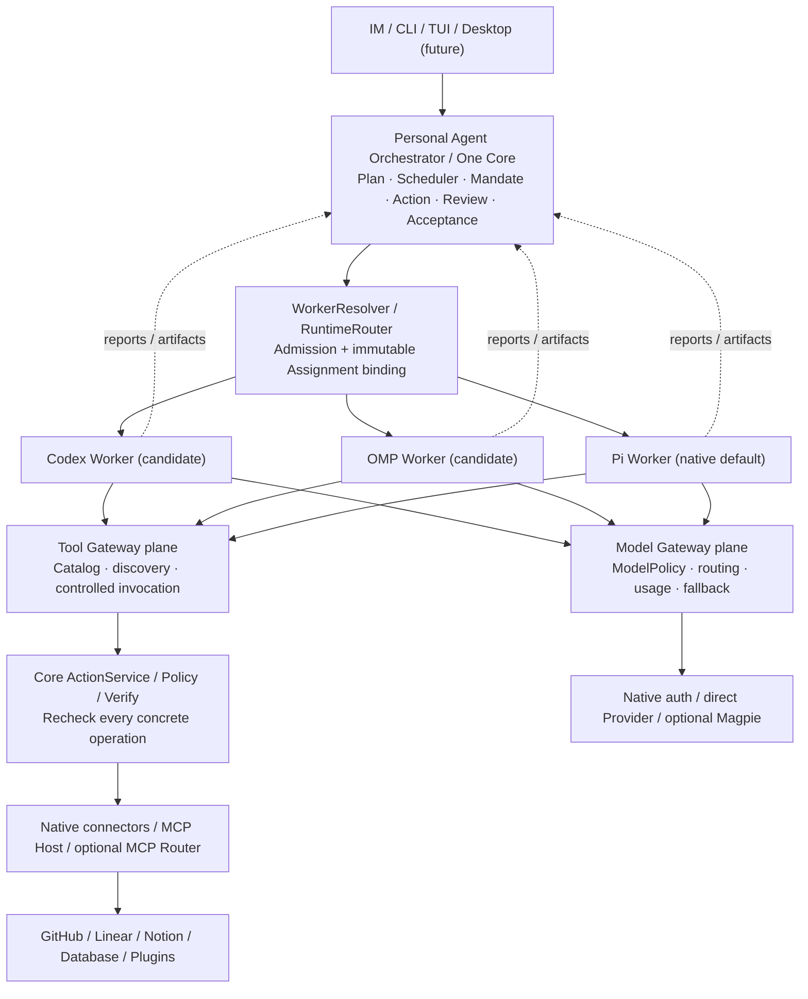

# 31 · Dual Gateway Architecture: Model & Tool

> 2026-11-27 · Accepted direction for planning; implementation and real acceptance pending. Complements [02](02-architecture.md), [13](13-model-routing-gateway.md), [25](25-extension-platform.md), [26](26-mcp-host.md), [30](30-multi-harness-worker-runtime.md). Does not change the MVP queue, L2/L3 release gates or existing evidence.
> Inspiration: owner-approved Orchestrator / multi-Harness / Model Gateway / Tool Gateway design; [Magpie MCP Router](https://usemagpie.ai/docs/mcp-router), [Magpie repository](https://github.com/yetone/magpie). Exact provider and tool protocol compatibility must be verified at implementation time.

## 1. Product decision

One Agent Core + WorkProfile × ExecutionStrategy × ModelPolicy + ExtensionPolicy + Worker execution binding. Two independent logical capability planes: inference (Model Gateway) and external tools (Tool Gateway). Neither is a second orchestrator, task database, policy authority or mandatory external service. CLI/TUI/IM/future Desktop share Core and Client API.

Arrows are logical capability relationships, not a promise to proxy every native Harness request. External Harness inference may be non-overridable; built-in shell/filesystem/network and MCP escape paths must be constrained at the driver/OS level. An external gateway is not an isolation boundary by itself. Tool Gateway is a façade over Extension Platform and Core ActionService, not a bypass or replacement. Local read-only workspace operations may be handled by an isolated driver, not necessarily routed over MCP.

## 2. Responsibility and current baseline

| Component | Owns | Reuses / status |
| --- | --- | --- |
| Orchestrator | task lifecycle, scheduling, revisions, cancellation, budgets, verification, review and owner acceptance | Coordinator/Plan/Assignment/Action/Inbox/Outbox, existing core; E3/E4 incomplete |
| Harness Adapter | dispatch, per-instance configuration, normalized events, actual isolation, artifacts, cancellation/recovery | docs/30; native Pi, interactive OMP pairing is not unattended driver |
| Model Gateway | logical model binding, provider/route capability, usage attribution, bounded fallback | docs/13; direct/native auth retained, optional external Magpie adapter; existing quota/usage read does not prove full routing |
| Tool Gateway | capability discovery, normalized tool contract, versioned registry, controlled invocation, optional external MCP Router | docs/25/26; existing ToolRegistry, PluginCatalog, Credential Broker, task ExtensionPolicy, read-only MCP Host |
| Policy/ActionService | authoritative authorization, exact args, approval/claim, fencing, verification/reconciliation | existing Core; no duplicate policy ledger |
| Workflow | persistent Plan/Steps and task recovery; optional ephemeral tool composition | existing PlanExecutor; Code Mode not yet implemented |

No assumption that the same account can authorize every service, or that all combinations of Harness × Provider × Model × Tool backend work. External model and MCP endpoints configured independently, with distinct credentials/scopes and data egress policies.

## 3. Tool Gateway contracts (proposed, not existing API)

- ToolBackend: native connector, direct MCP Host, external MCP Router adapter. Expose capability inventory, health, version/endpoint, schema digest, discovery and invocation support; unsupported/unknown explicit.
- ToolBinding: owner/project/task/assignment/revision, backend instance, tool ID + concrete upstream identity, contract version/schema digest, catalog generation, policy version, credential reference (never raw token), resource constraints, budgets. Pin at assignment; recheck current authorization before discovery and invocation.
- Tool discovery returns only authorized, verified capabilities, bounded result count and schema bytes/tokens. Unknown operations denied. Search results, tool schemas and descriptions are untrusted; discovery never grants access. Host controls canonical names/argument schema and semantic read/write classification.
- Invocation resolves actual target and canonical args before authorization, not just wrapper names such as find_tools/call_tool/run_code. Existing ActionService owns proposals, approvals, exact argument hashes, claims, receipts, replay/reconcile. No generic pass-through write. Unknown side-effect status stops/reconciles; no blind retry.
- Credential Broker owns purpose-specific credential references for direct connections; external gateway may own downstream OAuth/refresh, but PA stores only scoped gateway credentials and knows effective identity/authority. Connect != project binding != permission to write. Revoke/disable fences queued and running work; distinguish local disconnect and provider revoke.
- Preserve current compiled read-only contracts, namespace, catalog generation, result/timeout limits, SSRF/DNS pinning and explicit trusted-host policy. Do not classify a gateway wrapper or arbitrary tool as read-only based on name or annotation.

## 4. External Magpie pilot

Prefer adapter over rebuilding proxy, OAuth or MCP registry. First validate explicit local loopback configuration on Node, then separately validate remote TLS/auth and allowed egress. Use a dedicated least-privilege read-only account, pinned gateway version, explicitly configured endpoint, verified tool/operation allowlist and a disposable repo. No production credentials in external worker environment. Do not expose the proxy port by default.

Validate actual MCP initialization/list/call/discovery semantics and backend identity; if gateway cannot expose concrete operations or enforce narrow scope, reject generic wrappers and keep direct MCP/native typed connectors. No raw multi-tool gateway access for unattended external workers. Gateway failure must not silently switch credential, server or provider. Direct path remains independently usable under explicit binding and policy, without requiring Magpie installation. Native-auth inference continues without Model Gateway proxy. Avoid duplicating registry or credential store; retain direct GitHub REST evidence path.

## 5. Dynamic Tool Discovery

Start with bounded lexical discovery over the trusted, filtered local catalog; compare against full schema exposure. Return relevant tool IDs, descriptions and validated argument schemas with provenance. Provide safe retry/search refinement and exact-name fallback within the same allowlist. Harness native search may be reused only if equivalent enforcement and evidence hold. Discovery does not change tools allowed for the assignment; changes to catalog/schema/authority require revalidation or new binding. Test low recall, ambiguous name, malicious description, disabled tools, cross-project query, unknown schema, oversized results.

Benchmark fixed tasks with same model/harness/version and budgets: task success, tool discovery recall, total input/output tokens (including discovery and tool results), round trips, p50/p95 latency, actual cost or unknown, policy violations (zero required). Do not promise token savings or accuracy until measured. If a task uses most tools, discovery may increase cost.

## 6. Dynamic Workflow / Code Mode (later)

A separate constrained execution capability for short-lived composition (read/fetch/filter/join/aggregate), not a durable workflow engine. Model-generated code is untrusted. First evaluate external implementation or isolated bounded sandbox with deterministic fake tools. No filesystem, arbitrary network, env secrets, process creation, unbounded loops or direct tool credentials; apply wall time, CPU, memory, call count, output and nesting limits. Every leaf call is resolved and checked by Core (identity, Mandate, ExtensionPolicy, binding, args, budget, cancellation, approval); no opaque arbitrary code that can issue external writes. Initial version only verified reads and bounded pure computation, no writes. For future writes, require separately reviewed typed Actions with individual approval and receipts; never grant script-wide approval by default. If leaf authorization/audit cannot be guaranteed, disable Code Mode.

Return bounded result plus auditable leaf receipts and provenance; redact secrets and unrelated project data. Persist operation state/unknown outcomes as appropriate; do not infer completion from successful script exit. Long-running/recoverable tasks stay in Core PlanExecutor. Candidate code may be saved as a versioned, reviewed Skill artifact; never self-install, auto-enable or expand permissions. Existing SKILL.md loader remains guidance-only until explicit executable-skill contract and isolation are approved.

## 7. Independent Review and final acceptance

Role and capability are distinct from Harness identity. Example profiles: planner (read task/project state, propose plan), implementer (isolated workspace edits/tests, no main push), reviewer (read pinned head/base diff and evidence, isolated checks, no modifying acceptance criteria or implementation), verifier (read required CI/test/artifact evidence, no self-certification), owner (final acceptance/merge under existing policy). All may use same gateway but separate scoped bindings and credentials. Reviewer Assignment independent of implementer; new head invalidates prior review; test or CI unknown is not pass. Enforce both review and completion gates programmatically, not by prompt. No merge or deployment authority added by this design. Keep human involvement at requirements and final acceptance plus currently required sensitive approvals; further autonomy requires explicit owner policy and proven safety.

## 8. Delivery plan (dependency order, not date promises)

| Package | Priority / owner | Deliverable / exit gate |
| --- | --- | --- |
| DG-00 | design/spike; #69 + #63 + #36 | freeze plane boundaries and support matrix; verify existing MCP contracts, gateway version, and compatibility; no production writes |
| DG-01 | first optional integration; #69 + #68 + #63 | external MCP Router read-only adapter and explicit endpoint, scoped credential, catalog/fencing, test with native Pi; if incapable, report blocked and retain direct path |
| DG-02 | after MH-01/02 + DG-01; #63 + #69 + #73 | per-Worker binding and actual isolation; demonstrate two real compatible Harness workers sharing a tool backend with disjoint project scopes; no bypass |
| DG-03 | after DG-01/02; #69 + #70 | authorized dynamic discovery, bounded schemas, exact-name fallback, full-vs-lazy benchmarks |
| DG-04 | later; #69 + #70 + #71 | optional sandboxed read-only Code Mode, leaf-level authorization/audit, quotas, cancellation and failure evidence; persistent workflows remain Core-owned |
| DG-05 | later; #73 + #71 + #64 | reusable reviewed skills, management via Client API/CLI/TUI/future Desktop, SDK only after isolation; evaluate if native router is justified |

Model Gateway work remains #35–#37 and MH-00–06; no dependency requiring a model proxy before a tool proxy, or vice versa. #67 owns catalog, #68 credential lifecycle, #69 MCP/Tool Gateway, #70 Skills/discovery, #71 SDK/isolation, #63 runtime binding, #64 independent review. Existing #61 typed write policy, #7 budgets and #28 security gates remain. DG IDs are subpackages, not new issue IDs. Current #41/#92/#65 MVP/L2 real acceptance remains priority; DG-00 may run in parallel, implementation only after the same owner approval/gates as docs/30. A self-built MCP proxy is deferred until external adapters demonstrably fail requirements.

## 9. Acceptance matrix (DG01–DG12)

| ID | Required evidence |
| --- | --- |
| DG01 | Core and direct provider/connector run with both optional gateways absent; failure does not break unrelated paths |
| DG02 | verified gateway read matches direct REST/MCP result at pinned SHA; record actual versions and backend identity |
| DG03 | two real supported Harnesses use same backend, independent session/home/project/credentials; cross-project read denied |
| DG04 | unknown provider/tool/schema, remote read-only forgery, unauthorized discovery and generic call wrapper rejected |
| DG05 | disabled/revoked tool/credential/assignment between discovery, proposal and claim rejected; in-flight unknown reconciled |
| DG06 | malicious remote description/result and prompt injection cannot change permission or call arbitrary URL |
| DG07 | timeouts, response limits, disconnect/restart, cancellation and budget exhaustion observable; no blind write replay |
| DG08 | native tool/search bypass and inherited credentials blocked for unattended driver; otherwise supervised-only |
| DG09 | full vs lazy tool exposure benchmark with task success, tokens, cost, latency, retrieval failures; no unsupported savings claim |
| DG10 | Code Mode leaf permission and audit, loops/resource/secret/network escape negative cases, partial failure and cancellation; initial version no writes |
| DG11 | developer cannot approve own review/acceptance or merge; pinned SHA and independent evidence required; new head invalidates old review |
| DG12 | UI/API show requested vs actual provider/model/backend, status, revocation, usage source and unknown; no secrets in logs/backups |

E1 fake tests vs E2 integration vs E3 owner real scenario vs E4 recovery evidence explicitly separated per docs/08; record commit SHA, OS, provider/harness/gateway versions, policy/binding generation, trace/receipt IDs, real/mock, PASS/FAIL/PARTIAL/BLOCKED. Do not mark any new acceptance complete on design merge. Cross-platform/DO/remote support requires separate evidence.

## 10. Deferred decisions

First external tool backend and supported harness versions, external gateway trust/egress, credential scope, discovery quality threshold and token budget, Code Mode runtime/SDK, build-vs-buy of own MCP Router and any write expansion require owner review based on pilot evidence. No mandatory external dependency, new public port, database migration or implementation in this design change.
